# group05 

## Team members
Afonso Saraiva: up202304461@up.pt
Daniel Marques: up202306365@up.pt
Inês Francisco: up202304726@up.pt

# Public Key Infrastructure Lab

## Enviroment Setup

In this lab, we will generate public-key certificates, and then use them to secure web servers.

The HTTPS web server we used was the "www.danielmarques2025.com" server. In order to use that server, we must map the name we chose to the container's IP address, which is ``10.9.0.80``. We do that by adding the following line to the file ``/etc/hosts``.

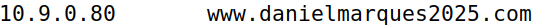

## Task \#1: Becoming a Certificate Authority

In this task, in this lab, we need to create digital certificates. We will become a root CA ourselves, and then use this CA to issue certificate for others. In this task, we will make ourselves a root CA, and generate a certificate for this CA. Unlike other certificates, which are usually signed by another CA, the root CA’s certificates are self-signed.

First, in order to use OpenSSL to create certificates, we must have a configuration file. In our case we created a copy of the configuration file called ``MyCA openssl.cnf``. The image below shows the CA_Default configuration settings we must have. The only thing we had to change here was uncomment the line related to ``unique_subject``, to allow the creation of certifications with the same subject.

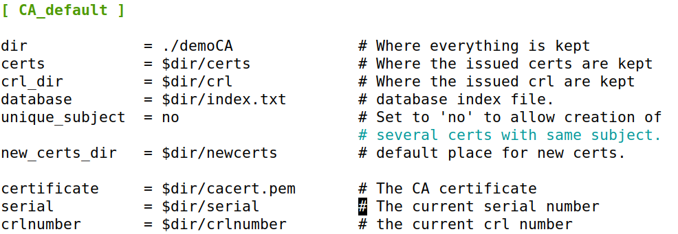

Next we must  generate a self-signed certificate for our CA. This means that this CA is totally trusted, and its certificate will serve as the root certificate. To do that we run the command below.

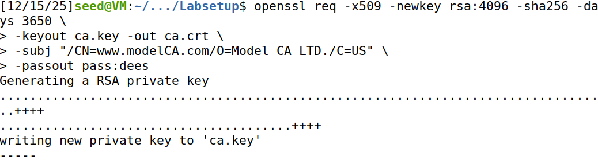

The output of the command is stored in two files: ca.key and ca.crt. The file ca.key contains the CA’s private key, while ca.crt contains the public-key certificate.

Its possible to check the content of the X509 certificate and the RSA key, we can do the command ``openssl x509 -in ca.crt -text -noout`` for the certificate and ``openssl rsa -in ca.key -text -noout`` for the key. We can see the output for each one below.

## Output CA

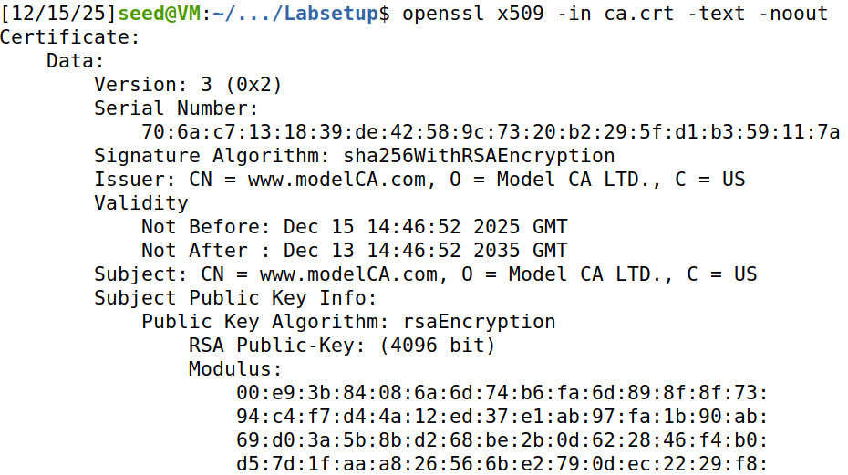
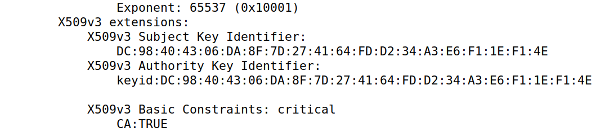

## Output Key

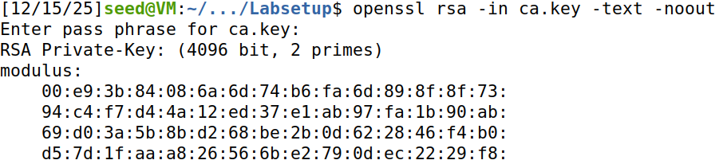
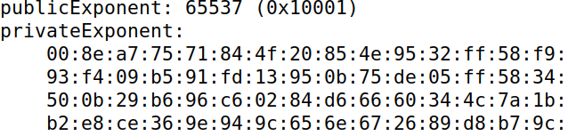
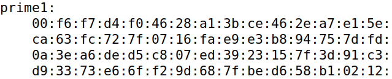
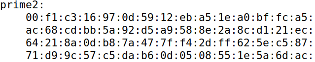

There is a lot of important information in both of these outputs.

## What part of the certificate indicates this is a CA’s certificate?

The certificate is identified as a Certificate Authority (CA) certificate based on the Basic Constraints extension. Specifically, the following field explicitly designates the certificate as a CA and marks the constraint as critical:

X509v3 Basic Constraints: critical
    CA:TRUE

## What part of the certificate indicates this is a self-signed certificate?

The certificate is determined to be self-signed by comparing the Issuer and Subject fields. In this certificate, both fields are identical:

- Issuer:  CN = www.modelCA.com, O = Model CA LTD., C = US
- Subject: CN = www.modelCA.com, O = Model CA LTD., C = US

Further confirmation is provided by the Subject Key Identifier and Authority Key Identifier extensions. The matching key identifiers show that the signing key and the subject’s public key are the same:

X509v3 Subject Key Identifier:
    DC:98:40:43:...

X509v3 Authority Key Identifier:
    keyid:DC:98:40:43:...

## Identify RSA parameters (e, d, n, p, q)

The certificate uses RSA public-key cryptography with a 4096-bit key. The RSA parameters extracted from the certificate are as follows:

### Modulus (n):
    
n = RSA Public-Key: (4096 bit) Modulus:
    00:e9:3b:84:08:6a:6d:74:...

### Public Exponent (e):

Exponent: 65537 (0x10001)

### Private Exponent (d):

d = privateExponent: 00:8e:a7:75:71:84:4f:20:...

### Prime Factors:

### p (prime1):

p = prime1: 00:f6:f7:d4:f0:46:28:a1:...

### q (prime2):

q = prime2: 00:f1:c3:16:97:0d:59:12:...

These parameters define the RSA key pair used by the certificate for cryptographic operations.
 
## Task \#2: Generating Certificate Request

Now we want ``www.danielmarques2025.com`` to get a public-key certificate from our CA. First it needs to generate a Certificate Signing Request (CSR), which basically includes the company’s public key and identity information. The CSR will be sent to the CA, who will verify the identity information in the request, and then generate a certificate.

The command to generate a CSR is shown below. Its similar to to the self-signed certificate for the CA. The only difference is the -x509 option.

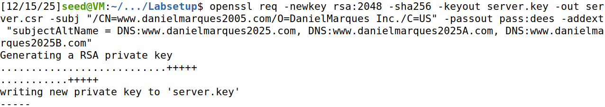

We also include the ``subjectAltName`` extension to allow the certificate to have multiple names.

The content of the CSR can be seen with the following command.

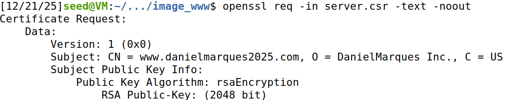
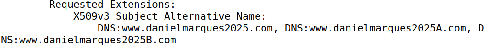

## Task \#3: Generating Certificate to own server

The CSR file needs to have the CA’s signature to form a certificate. In the real world, the CSR files are
usually sent to a trusted CA for their signature. We will use our own trusted CA to generate
certificates.

For that we must first change the ``MyCA_openssl.cnf`` file, by uncommenting the ``copy_extensions`` line, to allow the ``openssl ca`` command to copy the extension filed from the request to the final certificate.

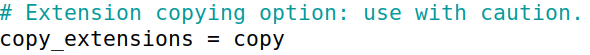

Next, we use the following command to turn our certificate signing request, ``server.csr`` into a X509 certificate, ``server.crt`` using the CA's ``ca.crt`` and ``ca.key``.

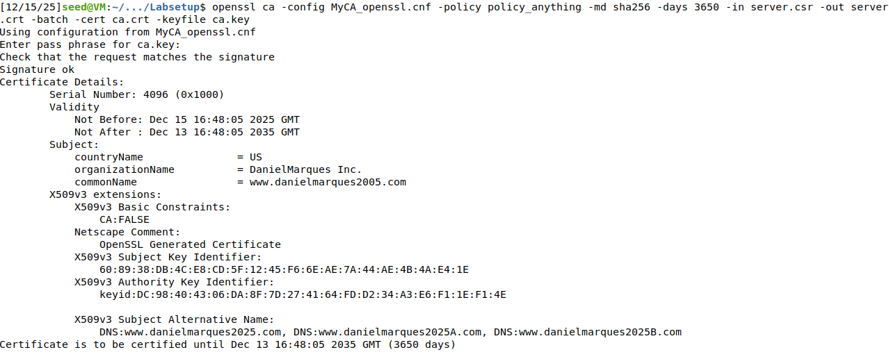

We use the policy, anything policy defined in the configuration file. This is not the default policy; the default policy has more restriction, requiring some of the subject information in the request to match those in the CA’s certificate. The policy used in the command, as indicated by its name, does not enforce any matching rule.

## Task \#4: Deploying Certificate in an Apache-Based HTTPS Website

In this task, we will see how public-key certificates are used by websites to secure web browsing. We will set up an HTTPS website based Apache.

First, we must change the dockerfile, so that the files that are sent to the server match the ones we want and not the default ones that were provided:

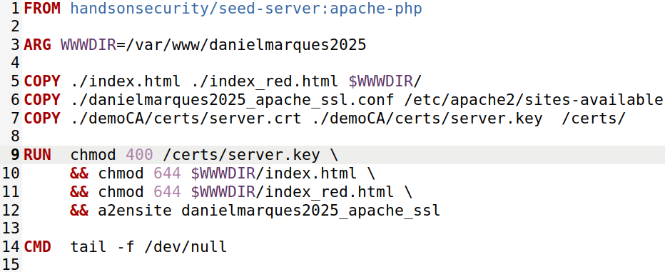

An Apache server can simultaneously host multiple websites. It needs to know the directory where
a website’s files are stored. This is done via its VirtualHost file, located in the /etc/apache2/sites-available directory. In our container, we have created a file called ``danielmarques2025_apache_ssl.conf`` which we copied from the provided one and changed the entries to our example.

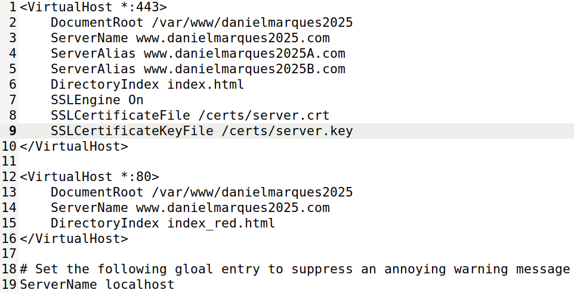

Next we must build the container and then start the Apache server inside that same container.

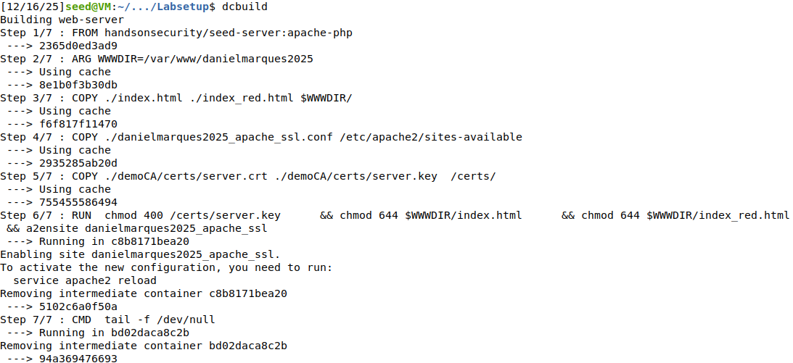

Now that everything is set up, we can browse to our website.

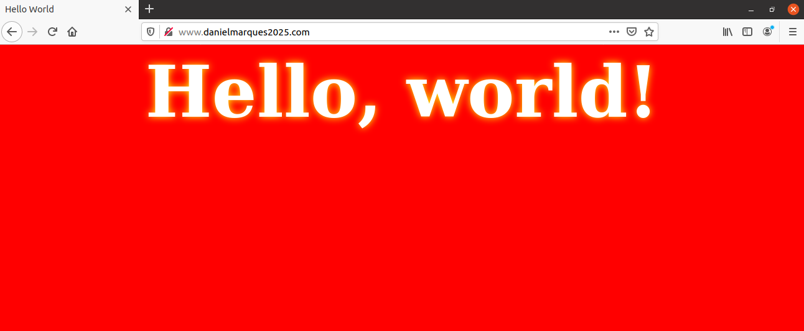

When attempting to access the web server by specifying https at the beginning of the URL, the browser displays a security warning, indicating that the site cannot be accessed securely.

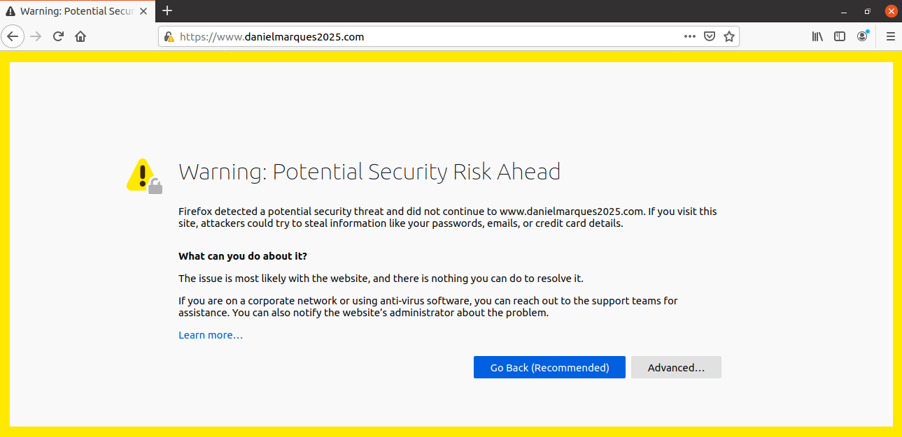

This happens because Firefox does not, by default, trust the certificate used to sign the website. For the connection to be considered secure, Firefox must trust the root CA that issued the server certificate. In this case, the root CA is not included in Firefox’s trusted CA list.

To resolve this problem, the root certificate must be explicitly added to Firefox’s list of trusted Certificate Authorities. Once the root CA is trusted, Firefox can successfully verify the website’s certificate, and the security warning is removed.

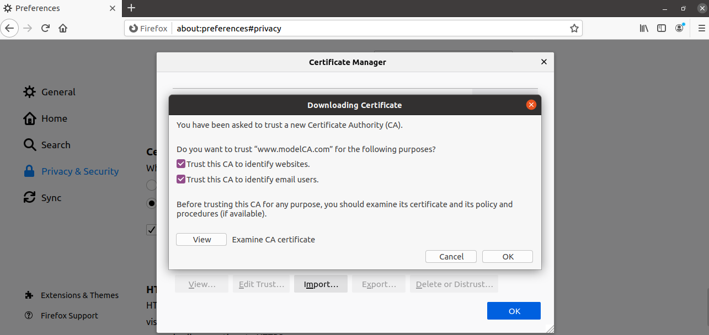
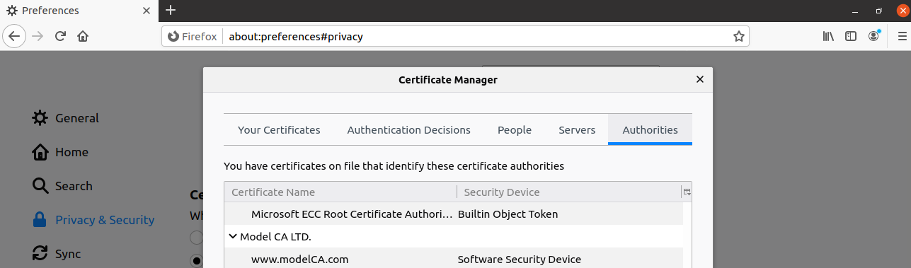

Now that Firefox trusts the root CA we created, if we try the same thing again, we will be successfull.

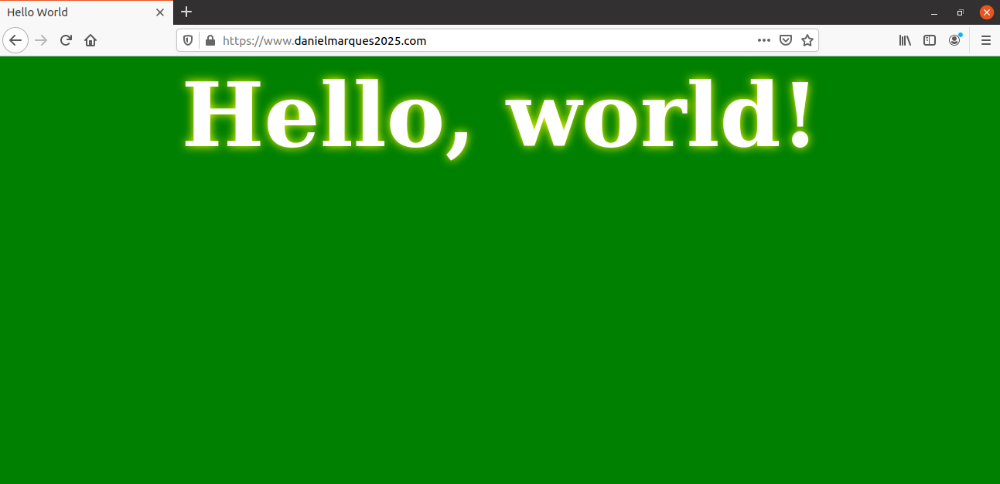

## Task \#5: Launch a Man-in-the-Middle Attack

What we did until now, we used a fake website created by us. Now we will try to do the same thing but for a real website with a lot of users. In our case, we picked ``www.reddit.com``.

First we have to map the ``www.reddit.com`` to the server we're using, by adding it to the ``/etc/hosts`` file

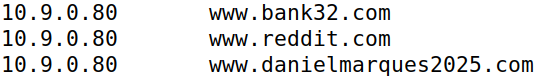

Next we have to change the apache file, so that the server name now is the one we want to impersonate.

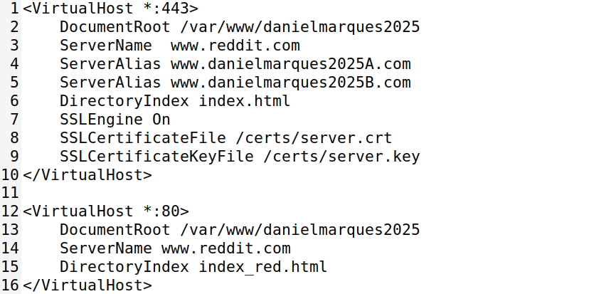

If we now visit ``www.reddit.com``, Firefox displays a security warning, indicating that the site cannot be accessed securely.

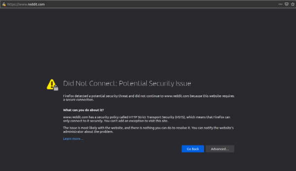

The reason this occurs is that the certificate we generated was issued specifically for the domain ``www.danielmarques2025.com``. When Firefox connects to ``www.reddit.com``, it verifies that the domain name in the URL matches the domain names listed in the certificate. Because ``www.reddit.com`` is not included in the certificate, this hostname verification fails and as a result, Firefox displays a security warning.

## Task \#6:  Launch a Man-in-the-Middle Attack with compromised CA

In this task, we simulated what happens when a CA's private key is stolen. 
Using our compromised CA, we created a fake certificate for ``www.reddit.com`` to see if we could now successfully do the attack that we couldn’t do in the previous task.

First we generated the certificate for Reddit using the CA's private key

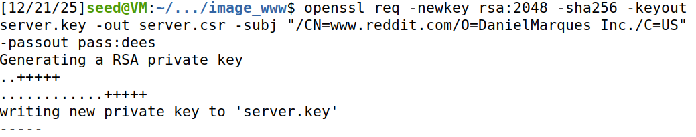

We confirm that now the certificate is for the domain we're trying to impersonate:

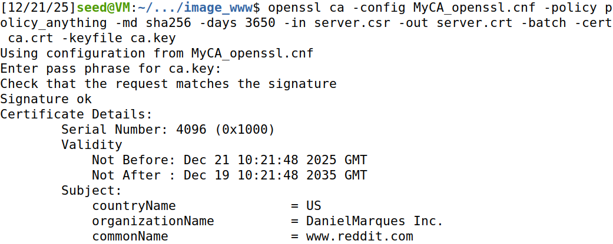

With the new certificate, signed by our root CA that is trusted by Firefox, we visited ``https://www.reddit.com`` again, and this time, the browser showed no warnings when visiting ``https://www.reddit.com``, which means our attack was successful.

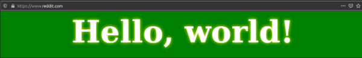

In conclusion, this task demonstrated that compromising a Certificate Authority enables undetectable man-in-the-middle attacks against virtually any website. Although our experiment used a self-created test CA, the same attack would be equally effective if the private key of a commercial CA were compromised.