# group05 

## Team members
Afonso Saraiva: up202304461@up.pt
Daniel Marques: up202306365@up.pt
Inês Francisco: up202304726@up.pt

# Sniffing and Spoofing Lab

## Setting Up the Environment with Containers

To begin the lab, we proceeded to build and launch the Docker environment required for the SEED Packet Sniffing and Spoofing lab. The following commands were used:
```bash
$ dcbuild
$ dcup   
```

### Verifying Running Containers

To ensure that all containers were running correctly, we listed the active Docker containers:
```bash
$ dockps
```

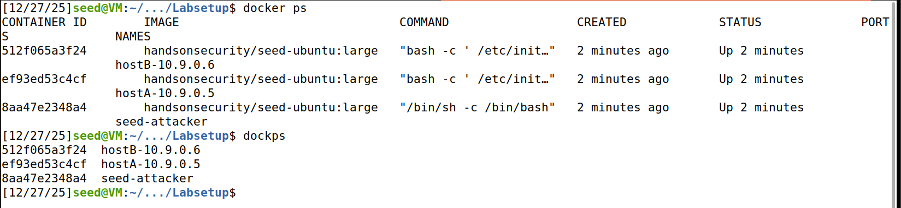

The output confirmed that three containers were successfully running:
- **hostB-10.9.0.6** (Container ID: 512f065a3f24)
- **hostA-10.9.0.5** (Container ID: ef93ed53c4cf)
- **seed-attacker** (Container ID: 8aa47e2348a4)

### Identifying the Network Interface

After starting the containers, we needed to identify the network interface created by Docker for communication between the VM and the containers. The network uses the IP prefix 10.9.0.0/24, with the VM assigned the IP address 10.9.0.1.

We used the `ifconfig` command to list all network interfaces and locate the one corresponding to our Docker network:
```bash
$ ifconfig
```

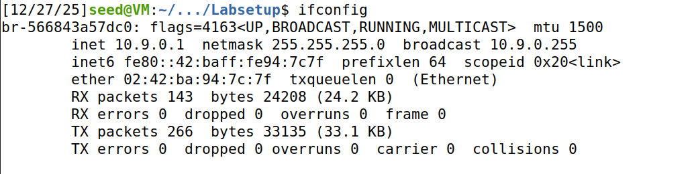

From the output, we identified the network interface as **br-566843a57dc0** with IP address 10.9.0.1.

## Task 1: Using Scapy to Sniff and Spoof Packets

To use Scapy, we write a Python program and execute it with root privileges.
```python
#!/usr/bin/env python3
from scapy.all import *

a = IP()
a.show()
```

### Testing Scapy - Creating a Simple IP Packet

We created a test script called `test_scapy.py` to verify that Scapy was working correctly in our environment. The script creates an IP packet and displays its fields.

First, we accessed the seed-attacker container:
```bash
$ docker exec -it seed-attacker bash
```

Then, we created and made the script executable:
```bash
root@VM:/# nano test_scapy.py
root@VM:/# chmod +x test_scapy.py
```

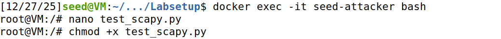

When we executed the script, it displayed the IP packet structure:
```bash
root@VM:/# ./test_scapy.py
```

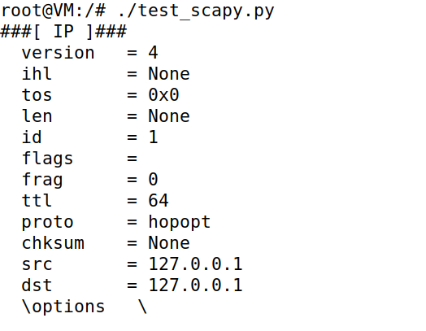

The output shows the default values for an IP packet created by Scapy.

This confirms that Scapy is properly installed and functioning in our container environment.

## Task 1.1: Sniffing Packets

### Objective

The objective of this task is to learn how to use Scapy to perform packet sniffing in Python programs.

### Implementation

We created a Python script called `sniffer.py` that captures packets on the network interface created by Docker. The script uses Scapy's `sniff()` function to capture packets and display their contents.

```python
#!/usr/bin/env python3
from scapy.all import *

def print_pkt(pkt):
    pkt.show()

sniff(iface="br-566843a57dc0", prn=print_pkt, count=5)
```

**Explanation:**
- `iface="br-566843a57dc0"`: Specifies the network interface to sniff on (identified in the setup phase)
- `prn=print_pkt`: Callback function invoked for each captured packet
- `count=5`: Limits the capture to 5 packets

We also gave permission for the script to run:

```bash
root@VM:/# chmod +x sniffer.py
```

### Task 1.1A: Running with Root Privilege vs Without Root Privilege

#### Generating Network Traffic

Since the containers **hostA** and **hostB** do not send packets by default, we needed to actively generate network traffic to demonstrate the packet sniffing functionality. We accessed **hostA** container and sent ping packets to **hostB**:

```bash
$ docker exec -it hostA-10.9.0.5 bash
root@ef93ed53c4cf:/# ping 10.9.0.6
```

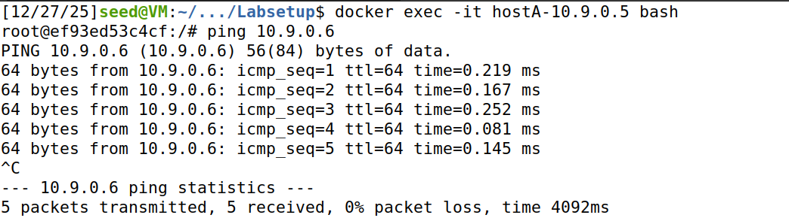


#### Running with Root Privilege

With the sniffer running in one terminal with root privileges, and the ping command generating traffic in another terminal, we executed:
```bash
root@VM:/# ./sniffer.py
```

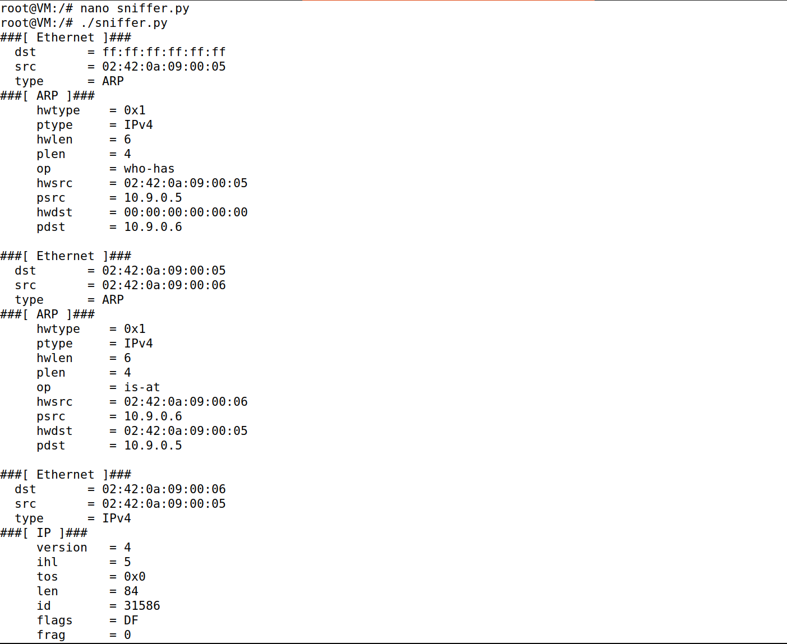

The program successfully captured 5 packets and displayed their details.


The sniffer captured multiple types of packets, demonstrating the different protocol layers:

  - Ethernet Layer (Layer 2 - Data Link)
  - ARP Packets (Address Resolution Protocol)
  - IP Layer (Layer 3 - Network)
  - ICMP Layer (Internet Control Message Protocol)

While not fully shown in the snippet, the ping packets would contain ICMP echo request/reply messages, which is the protocol used by the ping utility.

#### Running without Root Privilege

Next, we switched to the `seed` user account (non-root) and attempted to run the same program:
```bash
root@VM:/# su seed
seed@VM:/$ ./sniffer.py
```

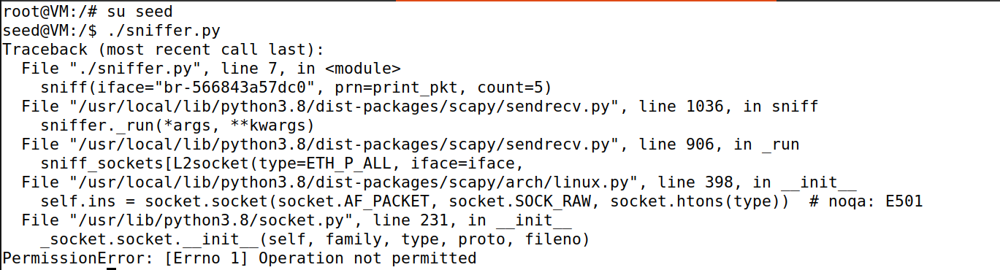

The program failed with a `PermissionError: [Errno 1] Operation not permitted` error.

The error message confirms that without root privileges, the program cannot create the necessary raw sockets (`socket.socket(socket.AF_PACKET, socket.SOCK_RAW, socket.htons(type))`) required for packet capture.

Packet sniffing is a privileged operation that requires root access. The `PermissionError` when running without root privilege is a security feature of the operating system that prevents unauthorized network monitoring.

### Task 1.1B: Capturing Specific Packets with Filters

In this task, we explored Scapy's filtering capabilities by using Berkeley Packet Filter (BPF) syntax to capture specific types of network traffic.

#### 1. Capturing Only ICMP Packets

We modified the sniffer script to capture only ICMP packets by adding a filter parameter:


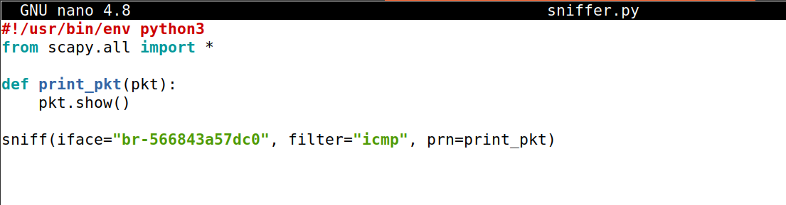

To generate ICMP traffic, we pinged from hostA to another IP:
```bash
root@VM:/# ./sniffer.py
```

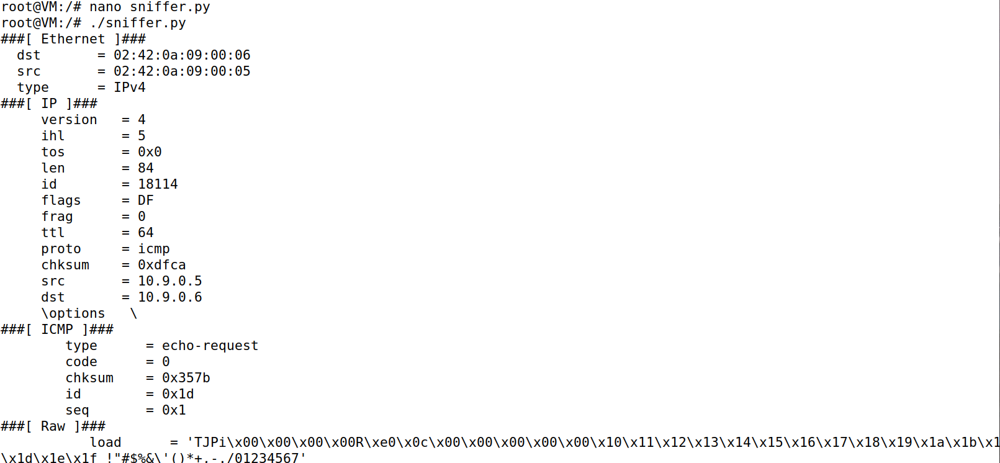

The filter successfully isolated only ICMP traffic, ignoring all other protocols.

The sniffer successfully captured ICMP echo-request packets with the following characteristics:

  - Ethernet Layer
  - IP Layer
  - ICMP Layer:


#### 2. Capturing TCP Packets from Specific Source to Specific Port

We then configured the sniffer to capture only TCP packets originating from host 10.9.0.5 and destined for port 23:

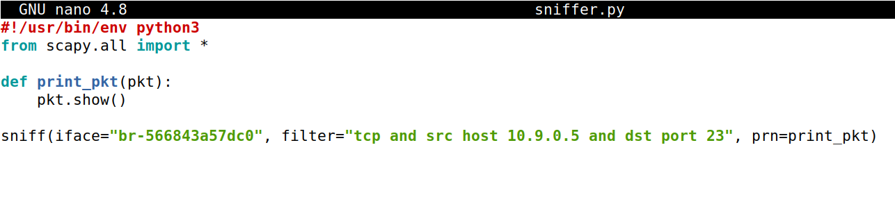

To generate matching traffic, we sent data from hostA to hostB on port 23:
```bash
$ docker exec -it hostA-10.9.0.5 bash
root@ef93ed53c4cf:/# echo "Host A para a porta 23 do Host B" > /dev/tcp/10.9.0.6/23
```

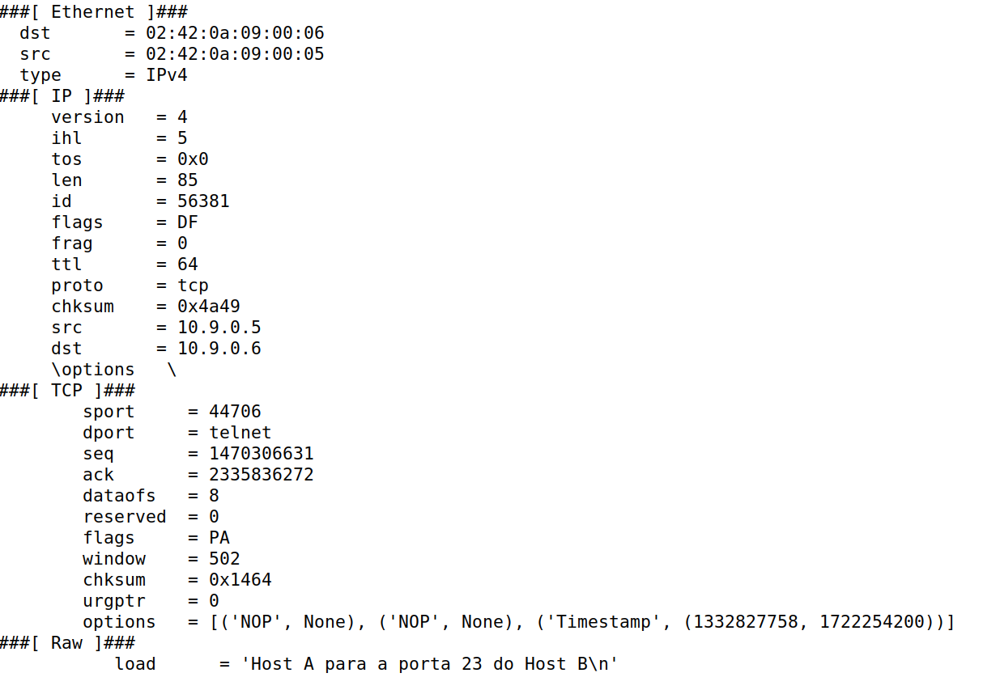

This demonstrates how BPF filters can precisely target specific network flows based on protocol, source/destination IP, and port numbers.

  - Ethernet Layer
  - IP Layer
  - TCP Layer:
  - Raw Layer (load)

#### 3. Capturing Packets from a Specific Subnet

Finally, we configured the sniffer to capture any traffic to or from the subnet 128.230.0.0/16:

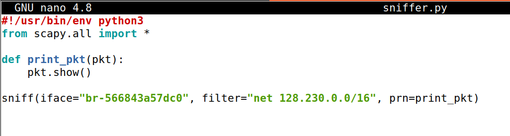

To test this filter, we pinged an IP address within that subnet from hostA:
```bash
$ docker exec -it hostA-10.9.0.5 bash
root@ef93ed53c4cf:/# ping 128.230.1.1
```

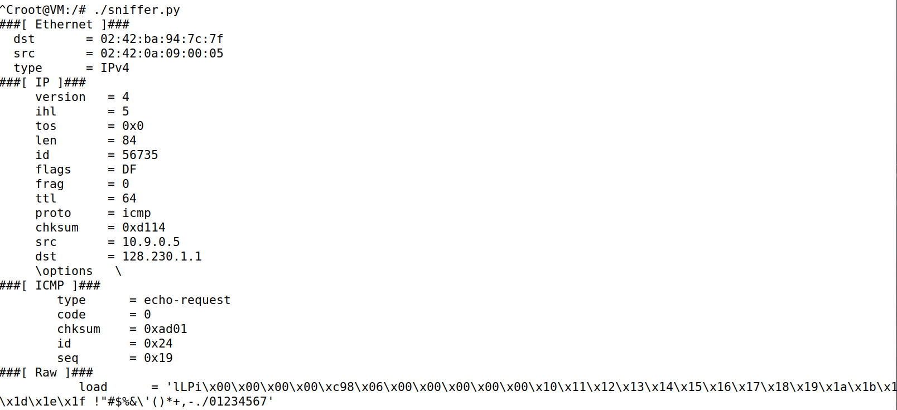

The sniffer successfully captured the ICMP echo-request packet destined for 128.230.1.1, which falls within the 128.230.0.0/16 subnet range. 

This filter is useful for monitoring all traffic exchanged with a specific network segment, regardless of the specific host or protocol used.

## Task 1.2: Spoofing ICMP Packets

### Objective

The objective of this task is to learn how to use Scapy to spoof ICMP packets with arbitrary source IP addresses. 

Packet spoofing is a technique where the sender modifies packet headers to make it appear as if the packet originated from a different source.

### Implementation

We created a Python script called `icmp_spoof.py` to spoof ICMP echo request packets:

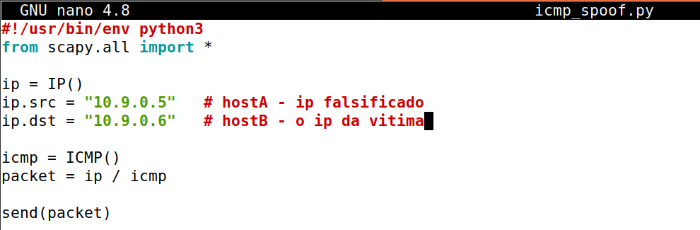

**Explanation:**
- **ip.src = "10.9.0.5"**: Sets the source IP address to hostA's address (the spoofed source)
- **ip.dst = "10.9.0.6"**: Sets the destination IP address to hostB (the victim)
- **icmp = ICMP()**: Creates an ICMP packet
- **packet = ip / icmp**: Combines the IP and ICMP layers using Scapy's `/` operator
- **send(packet)**: Sends the spoofed packet onto the network

### Verification with Wireshark

To verify that the spoofed packet was successfully sent and that hostB responded, we monitored the network traffic using Wireshark on the br-566843a57dc0 interface:

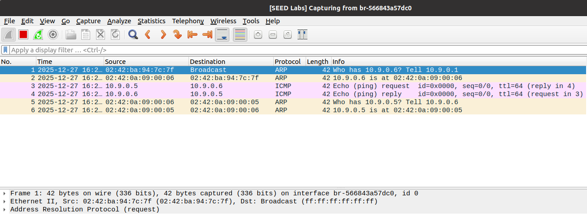

**Analysis of Captured Traffic:**

The Wireshark capture shows the following sequence:

1. **Packet 1 (ARP Request)**: Before sending the ICMP packet, the attacker machine broadcasts an ARP request asking "Who has 10.9.0.6? Tell 10.9.0.1"

2. **Packet 2 (ARP Reply)**: HostB responds with "10.9.0.6 is at 02:42:0a:09:00:06"

3. **Packet 3 (Spoofed ICMP Echo Request)**: 
   - **Source**: 10.9.0.5 (spoofed as hostA)
   - **Destination**: 10.9.0.6 (hostB)
   - **Protocol**: ICMP

4. **Packet 4 (ICMP Echo Reply)**:
   - **Source**: 10.9.0.6 (hostB)
   - **Destination**: 10.9.0.5 (the spoofed address)
   - **Protocol**: ICMP
5. **Packets 5-6 (ARP Exchange)**: Additional ARP packets for address resolution between the hosts


The packet was successfully sent with a forged source IP address (10.9.0.5), even though it was actually sent from the attacker machine (10.9.0.1).

The victim machine (hostB) accepted the spoofed packet without any authentication or verification of the source IP address, demonstrating a fundamental vulnerability in the IP protocol.


## Task 1.3: Traceroute

### Objective

The objective of this task is to estimate the distance, in terms of number of routers, between our VM and a selected destination. 

We did this by implementing a traceroute tool using Scapy.

The `traceroute` command is a network diagnostic tool that traces the path packets take from source to destination. It works by sending packets with incrementally increasing Time-To-Live (TTL) values:

  - When TTL reaches 0 at a router, the router discards the packet and sends back an ICMP "Time Exceeded" message
  - By starting with TTL=1 and incrementing it, we can discover each router along the path
  - When the packet finally reaches the destination, it responds with an ICMP "Echo Reply" instead

### Implementation

We created a Python script called `traceroute.py` that implements this functionality using Scapy:

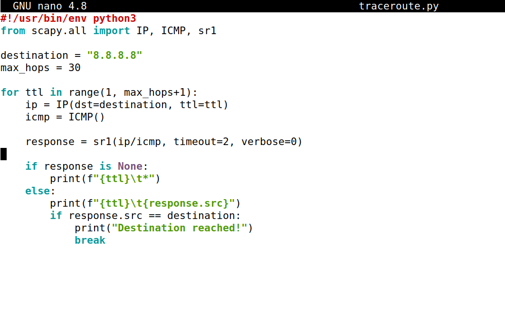

**Explanation:**

- **destination = "8.8.8.8"**: Target IP address (Google's public DNS server)
- **max_hops = 30**: Maximum number of hops to try before giving up
- **for ttl in range(1, max_hops+1)**: Loop through TTL values from 1 to 30
- **IP(dst=destination, ttl=ttl)**: Create IP packet with specific TTL
- **ICMP()**: Create ICMP echo request packet
- **sr1()**: Send packet and receive one response
  - `timeout=2`: Wait up to 2 seconds for a response
  - `verbose=0`: Suppress Scapy's output messages
- **if response is None**: No response received (router didn't reply or packet was lost)
- **else**: Print the IP address of the responding router
- **if response.src == destination**: Check if we've reached the final destination

### Execution and Results

We executed the traceroute script with root privileges:
```bash
root@VM:/# nano traceroute.py
root@VM:/# ./traceroute.py
```

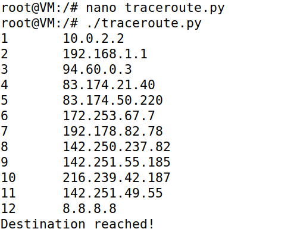

**Observations:**

1. **Total Hops**: The destination was reached in 12 hops
2. **Network Segments**:
   - Hops 1-2: Local network and home router
   - Hops 3-5: Internet Service Provider (ISP) network
   - Hops 6-12: Google's global network infrastructure
3. **Response Time**: All routers responded within the 2-second timeout

We successfully implemented a custom traceroute tool using Scapy that traces the path from our VM to a destination host by manipulating TTL values and analyzing ICMP responses. 

## Task 1.4: Sniffing and Spoofing

### Objective

The objective of this task is to combine packet sniffing and spoofing techniques. 

We will create a program that sniffs ICMP echo request packets and automatically sends back spoofed ICMP echo reply packets.

### Implementation

We created a script called `sniff_spoof.py` that combines both sniffing and spoofing capabilities:

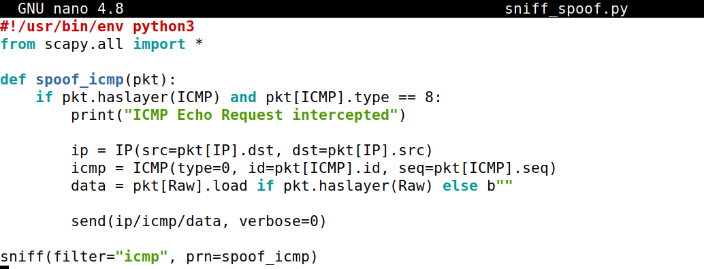

**Code Explanation:**

- **spoof_icmp(pkt)**: Callback function executed for each captured packet
- **if pkt.haslayer(ICMP) and pkt[ICMP].type == 8**: Checks if packet contains ICMP layer and is an echo request (type 8)
- **IP(src=pkt[IP].dst, dst=pkt[IP].src)**: Creates IP header with swapped source and destination
- **ICMP(type=0, ...)**: Creates ICMP echo reply (type 0) with matching ID and sequence number
- **data = pkt[Raw].load**: Extracts the payload data from the original packet
- **send(ip/icmp/data, verbose=0)**: Sends the spoofed reply packet

### Testing and Results

We tested the sniffing and spoofing script with three different ping scenarios from hostA to observe different network behaviors.

#### Setting Up the Test

We started the sniffing and spoofing script on the VM:
```bash
root@VM:/# ./sniff_spoof.py
```

Then, from hostA container, we executed three different ping commands to test various scenarios:

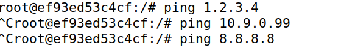


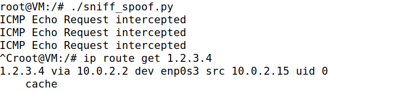

The output shows that our script successfully intercepted **three ICMP Echo Request packets**, one from each ping command. The script printed "ICMP Echo Request intercepted" three times, confirming that the sniffer captured all ICMP packets.

We also verified the routing configuration to understand the network path:
```bash
root@VM:/# ip route get 1.2.3.4
1.2.3.4 via 10.0.2.2 dev enp0s3 src 10.0.2.15 uid 0
    cache
```

This shows that packets destined for external networks (like 1.2.3.4) are routed through the gateway 10.0.2.2 on interface enp0s3.

#### Analysis of Each Scenario

**Scenario 1: Pinging Non-Existent Internet Host (1.2.3.4)**

When pinging 1.2.3.4 (a non-existent Internet host):
- The ICMP echo request was successfully intercepted by our script
- Our script sent a spoofed ICMP echo reply back to hostA
- Without the script, the ping timed out

**Scenario 2: Pinging Non-Existent LAN Host (10.9.0.99)**

When pinging 10.9.0.99 (a non-existent host on the local 10.9.0.0/24 network): no spoofing occurred as the target was not reachable

**Scenario 3: Pinging Existing Internet Host (8.8.8.8)**

When pinging 8.8.8.8 (Google's public DNS server, which actually exists):
- The ICMP echo request was intercepted by our script
- Our script sent a spoofed ICMP echo reply
- Without the script, normal replies were received

Our sniffer successfully captured all ICMP echo requests, regardless of destination

This task illustrates a fundamental network security vulnerability:
- Attackers can intercept network traffic and generate fraudulent responses
- Without proper authentication mechanisms (like IPsec), hosts cannot verify the authenticity of ICMP replies
- This type of attack can be used for denial of service, traffic manipulation, or reconnaissance
- Network administrators should implement ingress/egress filtering and monitor for suspicious ICMP traffic patterns
