# group05 

## Team members
Afonso Saraiva: up202304461@up.pt
Daniel Marques: up202306365@up.pt
Inês Francisco: up202304726@up.pt

# Environment Variable and Set-UID

## Task \#1

Environment variables are dynamic values that influence the behavior and configuration of running processes in Unix-like systems. Both the **printenv** and the **env** commands print the enviromental variables. The **export** command is used to set enviromental variables while the **unset** command is used to unset environment variables. Below there’s an example demonstrating all 4 of them.

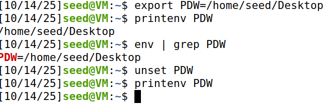

## Task \#2

To determine whether a child process created with the **fork()** system call inherits the environment variables of its parent process.

The initial program calls **fork()** to create a child process.  
In the child branch (after checking pid \== 0), the program executes **printenv()**, which displays all environment variables available to the child process. We compile and run the program and save the output result in a file called **file1**.

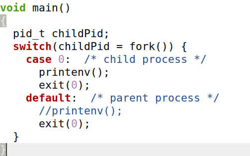
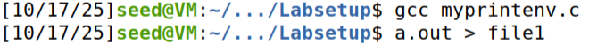

Then, we proceed to comment out the **printenv()** inside the child process and uncomment out the one in the parent process and execute the code again. This time we save the output result to a file called **file2**.

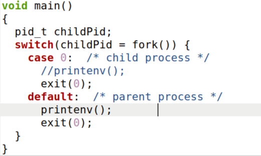
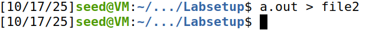

After saving both outputs to the respective files, the **diff** command is used in order to compare the files contents. The results show that the child process inherits all environment variables from its parent when created using the **fork()** system call. Both the parent and child have identical environment variable lists.

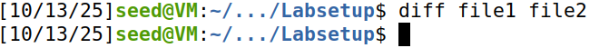

## Task \#3

The **execve()** system call replaces the current process image with a new program. Unlike **fork()**, it does not create a new process, instead, it overwrites the current process’s text, data, stack, and heap segments with those of the program being executed.

When **execve()** is called, the programmer can specify:

1. The path of the new program.  
2. The argument list (**argv**).  
3. The environment list (**envp**).

In this initial version, the program uses **execve()** to execute **/usr/bin/env**, which prints the environment variables of the current process. 

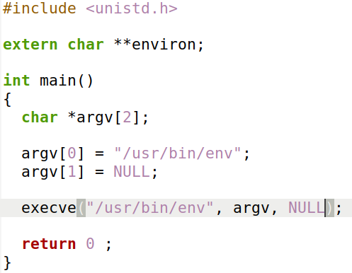

The output of the program shows no environment variables. This happens because we explicitly passed **NULL** as the environment argument, meaning the new program started with an empty environment.  

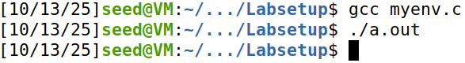

Next, we modified the code to pass the current environment (**environ**) from the calling process instead of **NULL**.

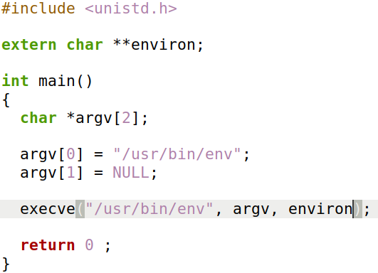

After this modification, the output displays the full list of environment variables of the process. This confirms that, when the environment pointer (**environ**) is passed as the third argument, the new program receives and uses the same environment variables as the calling process.

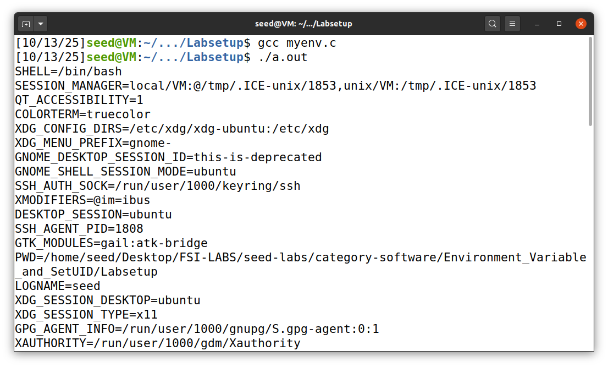

This demonstrates that a program executed via **execve()** does not automatically inherit the environment of the calling process, and its environment is entirely determined by the explicit pointer passed as the third argument, allowing precise control over which variables are available to the new process.

## Task \#4

The **system()** function is used to execute a command, but unlike **execve()**, which directly executes a command, **system()** actually executes **"/bin/sh \-c command"**, i.e., it executes **/bin/sh**, and asks the shell to execute the command. 

The program calls **system("(usr/bin/env")** to execute the **env** command via the shell. 

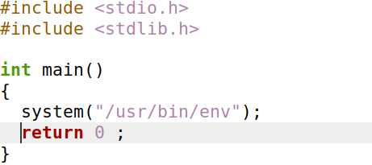

The output displays all the environment variables of the calling process.

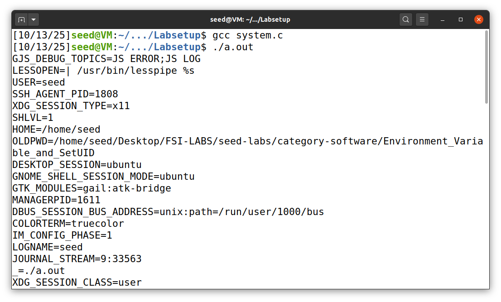

This experiment demonstrates that any program executed via **system()** inherits the environment variables of the calling process because **system()** internally invokes **/bin/sh** through **execl()**, which automatically passes the environment array, thereby providing seamless access to all existing variables without needing explicit specification.

## Task \#5

A **Set-UID** (Set User ID) program is a special type of executable that runs with the privileges of the file’s owner, rather than those of the user who launches it. For example, if a program owned by the root user has the Set-UID bit set, any user who runs that program will have the program executed with root privileges for the duration of its execution.

To convert a program, in this case a program called **foo**, into a **Set-UID** program owned by the root, the following commands were used:

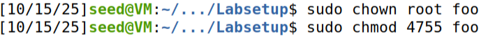

The **sudo chown root foo** changes the owner of the file **foo** to root. The **sudo chmod 4755 foo** command sets up the permission settings with the number 4755:

* 4 → sets the **Set-UID bit**, which makes the program run with the owner’s privileges (root).  
* 7 → gives the owner **read, write,** and **execute** permissions.  
* 5 → gives the group **read** and **execute** permissions.  
* 5 → gives others **read** and **execute** permissions.

While logged in as a normal user, three environment variables were exported in the shell  
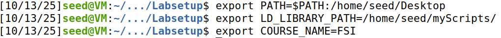
The **Set-UID** program was executed and its output filtered to search for specific variables  
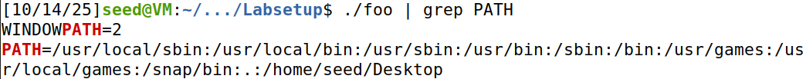
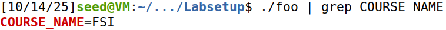
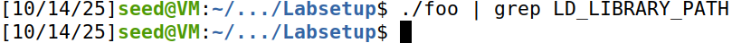

The environment variables behave differently under **Set-UID** execution depending on their potential impact on system security. Both the **PATH** and **COURSE\_NAME** variables are passed down to the **Set-UID** process. The **LD\_LIBRARY\_PATH** variable, however, is stripped out entirely because allowing it could enable an attacker to load unauthorized libraries with root privileges.

These results confirm that while **Set-UID** programs inherit most environment variables, Unix systems automatically filter out or modify those considered security-sensitive. 

## Task \#6

Calling **system()** within a **Set-UID** program is quite dangerous. This is because the actual behavior of the shell program can be affected by environment variables, such as **PATH**; these environment variables are provided by the user, who may be malicious. By changing these variables, malicious users can control the behavior of the **Set-UID** program.

To demonstrate how dangerous this could be, we started by creating a small program that executes the **/bin/ls** command; however, it is only used the relative path for the **ls** command, rather than the absolute path.

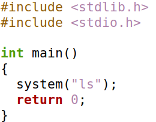

Then, we proceeded to change the ownership of the program to root and made it a **Set-UID** program.  

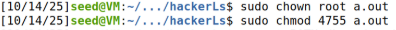

After that, we created a simple shell script, called **ls,** which is going to serve as our “malicious” code. In this case, the only thing that it does is print a message saying “Attack Successful" and executes the command **whoami,** which shows what user we are.  

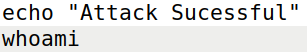

After that, we changed the **PATH** variable to add the directory where our “malicious” code is to the beginning of the **PATH** environment variable.  

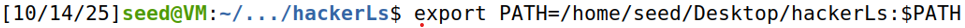 

Finally, we executed the code.  

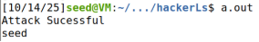

What we can observe is that in the end, the code that was executed was in fact the “malicious” code and not what we wanted. This worked because the program relied on the **PATH** to find **ls**, so the shell found and ran our “malicious” **ls** (from the front of **PATH**).

However, the program was not executed with root privileges, but with normal user privileges, as we can see by the output, where it says **“seed”.** This happens because the **system()** executes the **/bin/sh** program first, and then asks this shell program to run the command inside. Since in our Ubuntu version, the **/bin/sh**  is actually a symbolic link pointing to **/bin/dash,** and if dash detects that it is executed in a **Set-UID** process, it immediately changes the effective user ID to the process’s real user ID, essentially dropping the privilege.

So, in order to execute the program with root privileges, we have to use the command below to “**deactivate**” this feature.  

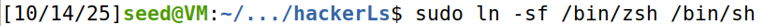

Then we execute the code again.  

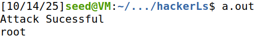

Since the output of **whoami** is **“root”** instead of seed, that shows the process's effective UID was root at that moment, so now the “malicious” code was executed with root privileges.

## Task \#8

As seen before, **system()** is quite dangerous if used in a privileged program, such as **Set-UID** programs, because it invokes shell, which can have dangerous consequences.

Knowing this, it's possible, for example, to manipulate files that we were not allowed to manipulate.

The program below is a simple C utility that displays the contents of a file provided as a command-line argument. When the program starts, it first checks whether the user has entered a filename. If not, it prints the message “Please type a file name.” and exits. If a filename is provided, the program prepares to use the Unix command **/bin/cat**, which prints the contents of a file to standard output. It stores **/bin/cat** as the command to run and the filename as its argument. Next, it dynamically allocates enough memory to build a complete command string such as **"/bin/cat filename"**, and then formats that string using **sprintf()**. After building the command, the program calls the **system()** function to execute it. The **system()** call starts a new shell and runs the **command** string, effectively performing the same action as typing **/bin/cat \<filename**\> in the terminal. As a result, the contents of the specified file are printed to the screen. 

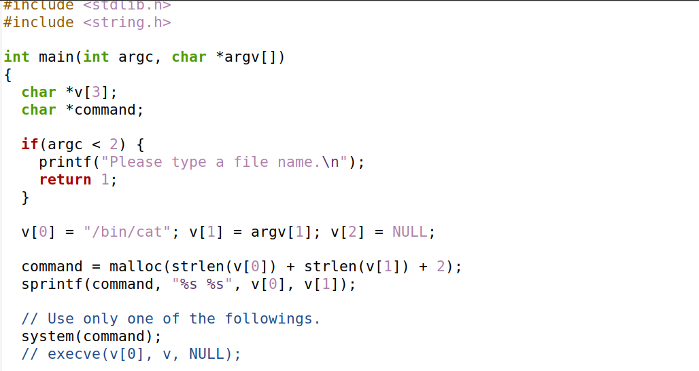

To carry out the exploit you first compile the given code. Then you create a file named **test.txt** containing the text “**Hello, this file has text”**. Next make the file owned by **root** and restrict its permissions so only the owner has access, preventing others from reading, writing, or removing it by setting the permissions with “**chmod 700 test.txt”.**

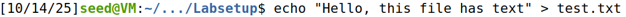
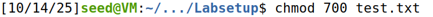
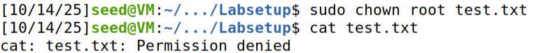 

As you can see, we now have a text file that we are not allowed to read its content. Now, in order to read its content, we have to change the ownership to root and make it a **Set-UID** program. If we then run the code and pass it the text filename, we are able to read the contents of the file.

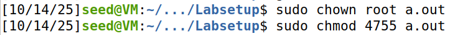
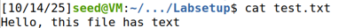

With all this done, it's now possible to exploit this vulnerability of the **system()** and delete the text file using the provided code. To do that we simply execute the code and in the place where we provide the filename, we instead/additionally provide a command to delete the file, in this case the command **“rm test.txt”**. You will be able to successfully delete the file that we had no permissions to.

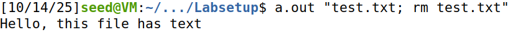
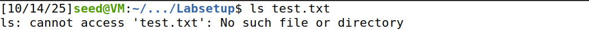

The reason this happens is because of how **system()** works. The **system()** function passes the string we give it to the shell, so the shell interprets and executes it instead of treating it as a single program with arguments. In this case, the program builds the command **"/bin/cat " \+ \<filename\>**. If we input the **\<filename\>** as **test.txt; rm test.txt**, the resulting string becomes **/bin/cat test.txt; rm test.txt.** The shell treats the **;** as a command separator and executes two commands in sequence: **/bin/cat test.txt** and then **rm test.txt**. That is why we are able to delete the **test.txt** file.

## Task \#9

**Set-UID** programs often permanently relinquish their root privileges if such privileges are not needed anymore.The **setuid()** system call can be used to revoke the privileges. When revoking the privilege, one of the common mistakes is **capability leaking**. **Capability leaking** is when a program unintentionally keeps or hands out privileged rights it shouldn’t — so code that’s supposed to run with reduced authority still has a way to do powerful things.

***Preparation***

In order to exploit and understand what **capability leaking** is, there’s some preparation that needs to be done. First we compile the following code:  

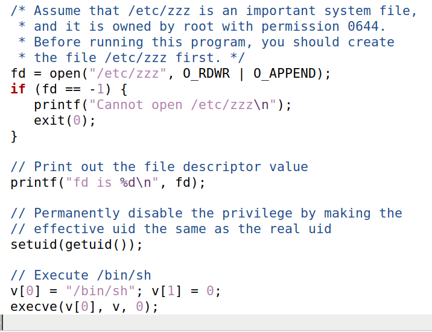

The program starts by declaring a variable **fd** to store a file descriptor and an array **v** to hold arguments for another program. It then tries to open the file **/etc/zzz** with read and append permissions. If the file opens successfully, it prints the number of the file descriptor that was returned. After that, the program calls **setuid(getuid())**, which sets the effective UID to the real UID. Next, it prepares to run a new program by setting **v\[0\]** to **“/bin/sh”** and **v\[1\]** to **NULL**. Finally, it calls **execve()** to replace itself with a new shell process (**/bin/sh**).  
After compiling the code, we then change its ownership to root and make it a **Set-UID** program.

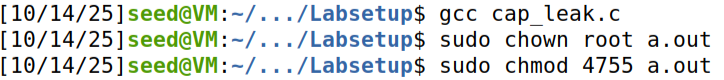

Now, we create a file called **/etc/zzz** which is gonna be our target file containing the sentence “Hello, this is the /etc/zzz important file”.

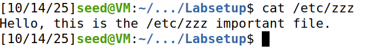

Afterwards, we change the ownership of our recently created file, the **/etc/zzz** file, and set its permissions.  

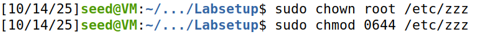

Now we have all the preparations necessary to exploit the program. If we run it normally and try to write to the target file like we would normally do using the command line, the program won’t let us, since we don’t have the permission to do that as we are a normal user (**seed**). 

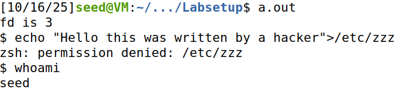

***Execution***

In order to be able to write in the target file is by making use of the capabilities obtained while the process was still a privileged process. By executing the command used below, while the process is running, without privileges, we can write new content to a file, even without having privileged access.   

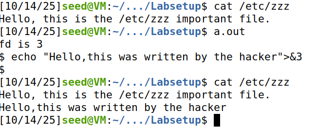

***Explanation***

The program allows an unprivileged process to write to **/etc/zzz** after **setuid(getuid())** because it opens the file while it still has root privileges, keeps the returned file descriptor, then lowers its privileges without closing or disabling that handle. When the program opens **/etc/zzz** the system checks permissions at that moment and returns a usable **file descriptor** (**fd**). That **file descripto**r itself acts as an access token (a **“capability**”) that grants whatever access the open provided, and it stays valid even after the program downgrades its privileges. The program then starts a shell, via **system()**, and by default the shell inherits the **file descriptor** the program kept. Because the shell now has that file descriptor to **/etc/zzz**, the unprivileged user can write to the file using the command **echo "text" \>&\<fd\>**.

***Mitigations***

Preventing capability leaks in **setuid** programs requires careful handling of privileges, file descriptors, and system capabilities. The following measures provide guidance on how to safely manage privileged resources, drop privileges properly, and design **setuid** programs to minimize the risk of unintentional access being retained by unprivileged code. 

1. **Open files after dropping privileges:** Whenever possible, a program should drop elevated privileges with **setuid()** (or equivalent) before opening sensitive files or resources. This ensures that the program accesses files only with the permissions of the intended unprivileged user, reducing the risk that a privileged handle could be misused or inherited by child processes.  
2. **Close privileged file descriptors:** Any **file descriptor** opened while the program still has elevated privileges should be explicitly closed before the program hands control to unprivileged code or executes a child process. This prevents unprivileged processes from gaining unintended access via inherited descriptors.  
3. **Clear all capabilities:** If the program uses or may have Linux capabilities, these should be explicitly cleared when dropping privileges. Use **cap\_clear()** and **cap\_set\_proc()** from **libcap**, or **prctl(PR\_SET\_KEEPCAPS, 0\)** to ensure no capabilities are retained across UID changes. This prevents leftover capabilities from bypassing UID-based restrictions.  
4. **Avoid unnecessary use of setuid:** Minimize the number of setuid-root programs and avoid granting more privileges than needed. When possible, replace setuid binaries with controlled, minimal privileged helpers.  
5. **Use least-privilege principles:** Design programs to operate with the minimum privileges required for each operation. Reduce the window of time during which the program runs with elevated privileges, and avoid combining privileged operations with unprivileged code. This approach limits the potential impact of any capability leaks or unintended access.

***Conclusion***

The core issue is not **setuid()** itself but failing to properly manage privileged resources. Mitigation involves minimizing the privileged window, opening sensitive resources only after dropping privileges, marking file descriptors **close-on-exec**, closing unnecessary descriptors, clearing capabilities, and avoiding spawning shells from privileged code. Applying these measures prevents capability leaks and ensures that downgraded processes cannot circumvent UID-based access restrictions.
