# group05 

## Team members
Afonso Saraiva: up202304461@up.pt
Daniel Marques: up202306365@up.pt
Inês Francisco: up202304726@up.pt

# Secret Key Encription
## Task \#1: Frequency Analysis

It is well-known that monoalphabetic substitution cipher (also known as monoalphabetic cipher) is not
secure, because it can be subjected to frequency analysis. To demonstrate this, we will try, using this technique, to decypher a text that is in english.

Firstly, we must know the frequency of each letter in the text we want to decypher. The code below does just that. The code what it does is, it reads a ciphertext file, generates 1-grams, 2-grams, and 3-grams (excluding any containing whitespace), counts how often each occurs, and prints the top 20 most frequent ones.

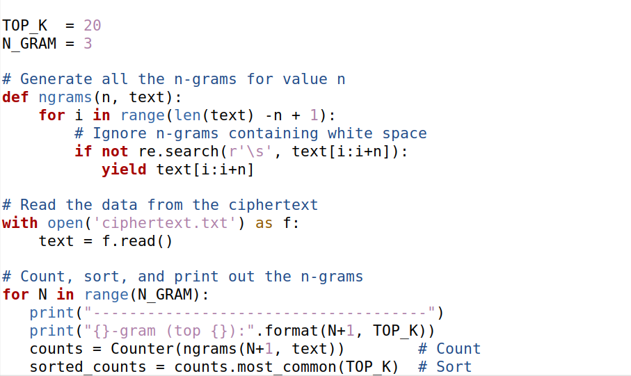

When we run it, the result obtained is the following

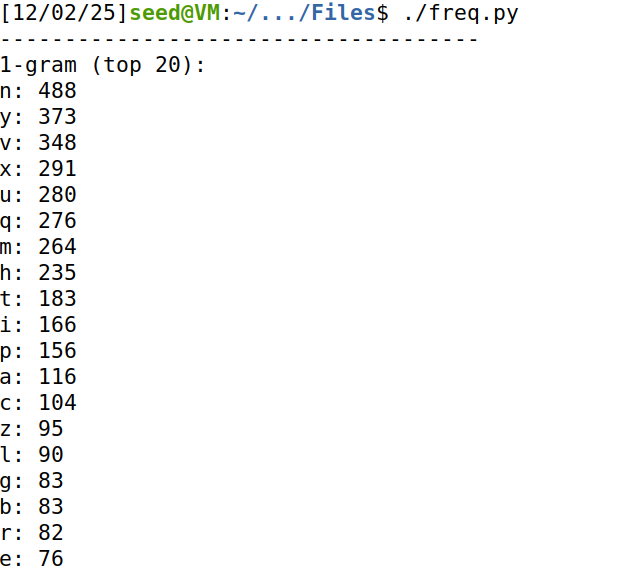
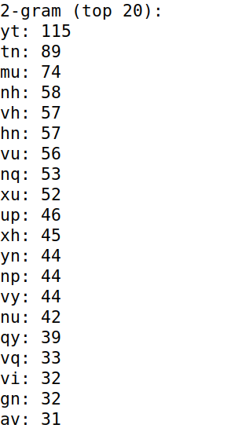
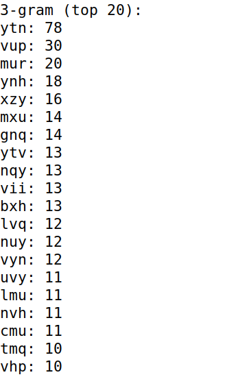

In order to be able to do this, we also need to look at a frequency table, so its easier to understand which letters are the most frequent in english words and sentences.

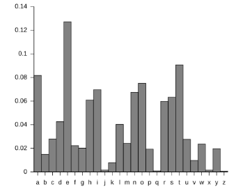

To register which letters we have already decyphered, each time we discover one, we change it to the correct corresponding capital letter. We can do that by using the ``tr`` command. The ``tr`` command allows to replace letters for capitals one in a text file and save the result in another text file.

Firstly, look at the top 3-gram result. It clearly shows that the combination ``"ytn"`` appears a lot more than the other ones. It makes sense that this combination corresponds to ``"THE"``, which is pretty common in the English language. This is also safe to assume because if we look at both the 1-gram results and the frequency table, we see that the letters ``"y"`` and ``"n"`` are the top 2, while in the frequency table, the letters ``"e"`` and ``"t"`` are also the top 2.

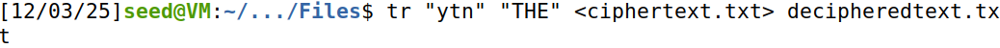

Next, notice the 2nd 3-gram result. Following the same logic as before, we conclude the combination ``"vup"`` corresponds to ``"AND"``. The 3rd and 5th 1-gram result is the letter ``"v"`` and ``"u"``. If we then look at the frequency table, we can see that the letters ``"a"`` and ``"n"`` are somewhat common.

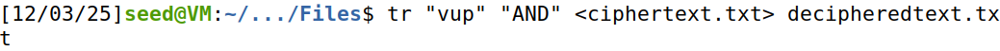

The same logic was apllied to find the letters ``"OR"``. The letter ``"x"`` is the 4th most used letter in our text and the combination ``"xh"`` is used often as well. If we look at the frequency table, the letter ``"o"`` is used almost as much as the letter ``"a"``.

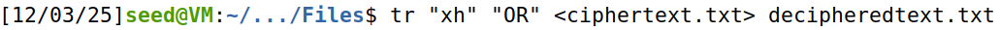

From this point, the text has enough information that we can start to look at it and discover the rest of the letters by making the words sound correct.

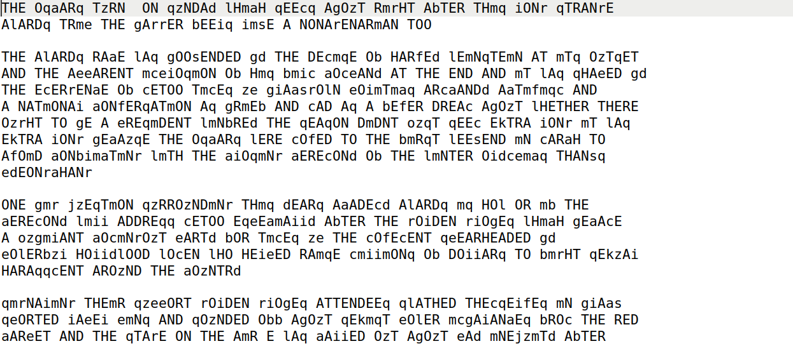

We can deduct some letters here, for example:

c -> M;
m -> I;
b -> F;
i -> L;
q -> S;

By discovering all the letters, we are able to decypher the full text.

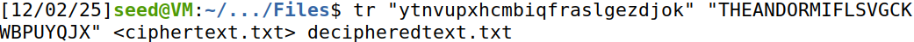

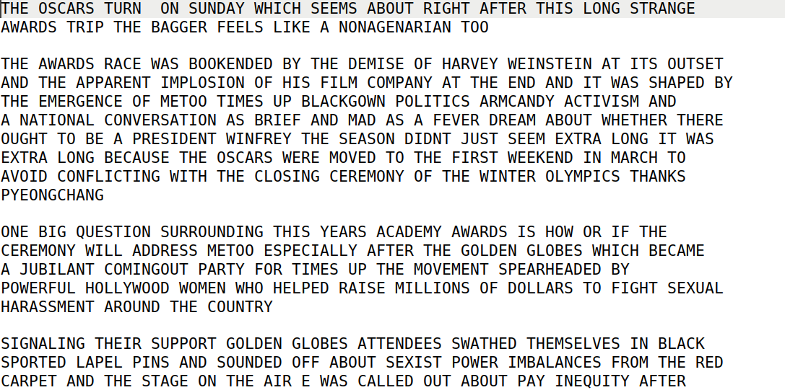

## Task \#2:  Encryption and Decryption using Different Ciphers and Modes

There are a variety of encryption algorithms and modes to choose from. The objective here is to focus on 3 particular cipher modes: ``Electronic Codebook (ECB)``, ``Cipher Block Chaining (CBC)``, and ``Counter (CTR)``.

To play with these modes, we will encrypt a text file called ``plaintext.txt``, that will contain the text we discovered previously, with each of the 3 modes mentioned.

The command used is ``openssl enc -ciphertype -e/-d -in <file> -out <file> -K <key> -iv <iv> ``. The command uses the following flags:

-ciphertype - type of cipher used;
-in <file> - input file;
-out <file> - output file;
-e - encrypt;
-d - decrypt;
-K <key> - key in hex is the next argument;
-iv (Initialization vector) <iv> - iv in hex is the next argument;

# Encryption
# ECB

To encrypt the file using the ECB cipher, we use the following command:

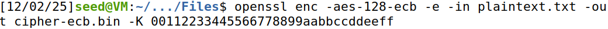

The flags specified were:

-ciphertype – We used -aes-128-ecb to select the AES-128 cipher in ECB mode.
-e – Indicates encryption.
-in <file> – Specifies the input file, which is ``plaintext.txt``.
-out <file> – Specifies the output file, where the encrypted data is stored ``cipher-ecb.bin``.
-K – Provides the encryption key in hexadecimal format.

# CBC

To encrypt a file using the CBC cipher, we use the following command:

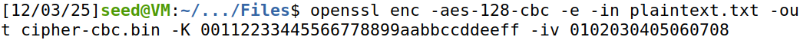

The flags specified were:

-ciphertype – We used -aes-128-cbc to select the AES-128 cipher in CBC mode.
-e – Indicates encryption.
-in <file> – Specifies the input file, which is ``plaintext.txt``.
-out <file> – Specifies the output file, where the encrypted data is stored ``cipher-cbc.bin``.
-K – Provides the encryption key in hexadecimal format.
-iv – Provides the Initialization Vector (IV) in hexadecimal format.

# CTR

To encrypt a file using the CTR cipher, we use the following command:

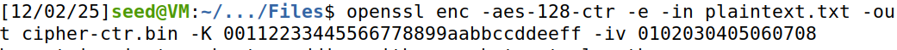

The flags specified were:

-ciphertype – We used -aes-128-ctr to select the AES-128 cipher in Counter mode.
-e – Indicates encryption.
-in <file> – Specifies the input file, which is ``plaintext.txt``.
-out <file> – Specifies the output file, where the encrypted data is stored ``cipher-ctr.bin``.
-K – Provides the encryption key in hexadecimal format.
-iv – Provides the Initialization Vector (IV). 

# Decryption
# ECB

To decrypt the file encrypted with ECB mode, we use the following command:

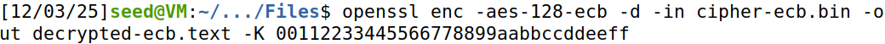

The flags specified were:

-ciphertype – We used -aes-128-ecb to select the AES-128 cipher in ECB mode.
-d – Indicates decryption.
-in <file> – Specifies the input file, which is ``cipher-ecb.bin``.
-out <file> – Specifies the output file where the decrypted plaintext is stored ``decrypted-ecb.txt``.
-K – Provides the encryption key in hexadecimal format

# CBC

To decrypt the file encrypted with CBC mode, we use the following command:

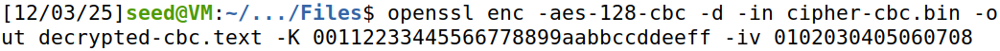

The flags specified were:

-ciphertype – We used -aes-128-cbc to select the AES-128 cipher in CBC mode.
-d – Indicates decryption.
-in <file> – Specifies the input file, which is ``cipher-cbc.bin``.
-out <file> – Specifies the output file ``decrypted-cbc.txt``.
-K – Provides the encryption key in hexadecimal format.
-iv – Provides the Initialization Vector (IV) in hexadecimal format, which matches the IV used during encryption.

# CTR

To decrypt the file encrypted with CTR mode, we use the following command:

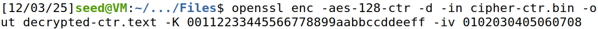

The flags specified were:

-ciphertype – We used -aes-128-ctr to select the AES-128 cipher in CTR mode.
-d – Indicates decryption.
-in <file> – Specifies the input file, which is ``cipher-ctr.bin``.
-out <file> – Specifies the output file ``decrypted-ctr.txt``.
-K – Provides the encryption key in hexadecimal format.
-iv – Provides the Initialization Vector (IV) in hexadecimal format, which matches the IV used during encryption.

# Comparison

``ECB`` mode is a block cipher mode that does not use an IV because each block of plaintext is encrypted independently. As a result, identical plaintext blocks produce identical ciphertext blocks, which can reveal patterns in the data. ``ECB`` is the weakest mode because it provides no semantic security and does not hide repeated content.

``CBC`` mode is also a block cipher mode and uses an IV. Each plaintext block is XOR'ed with the previous ciphertext block before encryption. This ensures that identical plaintext blocks produce different ciphertext, effectively hiding patterns. However, because each block depends on the result of the previous block, ``CBC`` encryption and decryption must be performed sequentially, which makes the mode slower and not parallelizable.

``CTR`` mode, contrary to the ``ECB`` and ``CBC`` modes, is a stream cipher mode that also uses an IV. The IV serves as the initial value for a counter, which is encrypted to generate a keystream. The plaintext or ciphertext is then XOR'ed with this keystream. Because it operates as a stream cipher, encryption and decryption are identical operations, blocks can be processed in parallel, and no padding is required.

## Task \#5:  Error Propagation – Corrupted Cipher Text

Changing a single byte of a encrypted text is enough to cause a loss of information. The objective is to compare the amount of information bytes that are lost in each of the 3 different modes mentioned earlier: ``ECB``, ``CBC``, ``CTR``.

To do this, we will use the editor ``bless`` and we will change 1 byte, the byte ``250`` (50 * 5), for each one. Then we will decrypt using each cipher and compare the results with the original text, which is the one in the file ``plaintext.txt`` used previously.

Adittionally we are going to use an aditional command, which is ``cmp -l <file1> <file2> 2>/dev/null | wc -l``. What this command does is count the number of differing bytes between the original file and the modified file. It works by using ``cmp -l <file1> <file2>`` to list every byte position where the two files differ, redirecting any error messages to /dev/null so they don’t appear, and then piping the result into ``wc -l``, which counts the number of output lines, where each line represents one differing byte.

# ECB

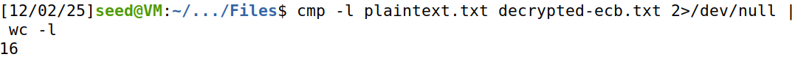
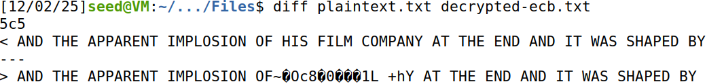

In the ``ECB`` mode, we lose 16 bytes of information. This happens because ``ECB`` treats every 16-byte block completely independently during both encryption and decryption. When you modify 1 byte of the ciphertext, the block that contains that byte no longer matches what the decryption algorithm expects, so the entire block decrypts to meaningless data. However, only that block is affected: the blocks before and after it do not depend on each other in ``ECB``, so they decrypt normally.

# CBC

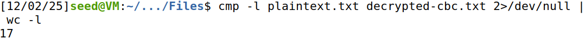
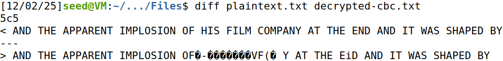

In the ``CBC`` mode, we lose 17 bytes of information. Each plaintext block is XOR'ed with the previous ciphertext block before being encrypted. This means that the encryption of each block depends on the ciphertext of the block before it. Consequently, if 1 byte in the ciphertext is modified, it not only corrupts the decryption of that block, but also affects the first byte of the following block. As a result, a single-byte change in the ciphertext can lead to a loss of 17 bytes of meaningful data during decryption: 16 bytes from the corrupted block and 1 byte from the next block.

# CTR

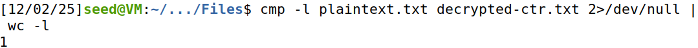
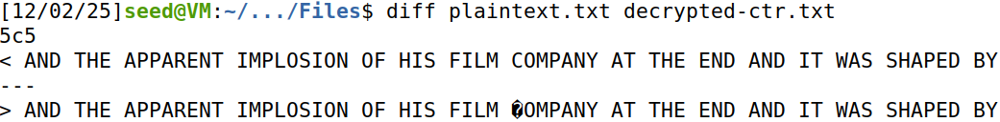

In the ``CTR`` mode, we lose 1 byte of information. In this mode, the encryption is perfomed by combining the plaintext with a keystream generated from a counter and the encryption key. Each block of plaintext is XOR'ed with a unique keystream block derived from the counter, which means that each block can be encrypted and decrypted independently. As a result, if a single byte in the ciphertext is modified, only the corresponding byte in the decrypted plaintext is corrupted, while the rest of the message remains unaffected.

## Challenge

In this challenge we want to decipher a text, that was ciphered using a ``Vigenère cipher`` and answer to the question "What happens to fat cats?". 

# Vigenère cipher

A text was encrypted using a ``Vigenère cipher``. A ``Vigenère cipher`` is a substitution cipher that encrypts text by shifting it according to a repeated key.

How it works:
1 - Write the message and repeat the key until it matches the text to be encrypted.
2 - Add the corresponding indexes and then do the absolute value of the size of the text to have the encrypted symbol.

In this case, the size is going to be 36, where "A" has index 0, "H" index 7, "Z" index 25, "0" index 26 and "9" index 35.

# Decrypting the text

The following text was ciphered using the ``Vigenère cipher`` and a key of size 5.

``"N516MHZIFBN5OEDSVKGIY9WD7T4MD9YBP6MJDWDPY0WFOF2MAOXBWDGNX6GPH62D8K3Q4FFA4AOHZIF8T7MFTTCZVMIW66TTCLK9JBP2O1W09JZ3LF90WZ39FXZ2DIBW5DJ9QK9Z7IF8YSS6OMWXGRJ9J27P01KON4MLCJ"``

In order to decipher this text, we can follow a couple of steps.

First, we need to find the key that was used. The clue we were given was ``"Fundamentos de Segurança Informática"``. By taking the initial letter of each word, we get the course's acronym, ``FSI``. Just this is not enough, since the key is 5 letters and this is only 3 letters. Since the course is being taken in the year 2025, we decided that it would make sense for the key to be ``FSI25``. 

Next is the deciphering part. To decipher it, we must use the index of the letter in the ciphered text, subtract the index of the letter in the key and then do the absolute value of that with 36. The equation would be: ``Originaltext index = (Cipher index - Key index) % 36``. Now all we to do is apply that formula to every letter of the ciphered text and we will have our original text. 

The original text is the following:

``"INTERCHANGING MIND CONTROL COME LET THE REVOLUTION TAKE ITS TOLL IF YOU COULD FLICK A SWITCH AND OPEN YOUR 3RD EYE YOUD SEE THAT WE SHOULD NEVER BE AFRAID TO DIE RISE UP AND TAKE THE POWER BACK ITS TIME THE"``

A quick google search reveals that this is a part of the lyrics of a song called "Uprising" by the band "Muse". In those same lyrics, we can find the answer to our question: "It's time the fat cats had a heart attack"
